# Capítulo 1. Introducción al mundo de IT

> Traducción al español del Capítulo 1 («Introduction to the World of IT») de *Complete A+ Guide to IT Hardware and Software: CompTIA A+ Exams 220-1101 & 220-1102* (Cheryl A. Schmidt, Christopher Lee) — material de estudio de uso personal.
>
> Nota: las figuras del libro son imágenes y no se incluyen aquí; se conserva su leyenda traducida como referencia.

En este capítulo aprenderás:

- Las cualidades que debe tener un técnico
- Las habilidades básicas necesarias para desenvolverte en el entorno de Windows y en el mundo técnico
- Las partes importantes de una computadora
- Términos básicos de informática

**Objetivos del examen CompTIA:**

- 1101-3.1 Explicar los tipos básicos de cables y sus conectores, características y propósitos.
- 1101-3.6 Dado un escenario, desplegar y configurar dispositivos multifunción/impresoras y sus ajustes.
- 1102-4.4 Dado un escenario, usar procedimientos de seguridad comunes.
- 1102-4.7 Dado un escenario, usar técnicas de comunicación adecuadas y profesionalismo.

## ¿Quién necesita este libro?

Más tipos de personas de los que podrías pensar a primera vista necesitan este libro. Quienes obviamente necesitan esta información son los que repararán computadoras o trabajarán en una mesa de ayuda (*help desk*) o mesa de soporte (*support desk*). Sin embargo, existen otros tipos de usuarios que podrían no ser tan obvios. Muchas personas que entran al mundo de la tecnología de la información (IT) lo hacen a través de trabajos que exigen la certificación A+. Considera a los técnicos de electrónica médica que reparan equipos comunes usados en hospitales. Estos técnicos necesitan este material porque muchos dispositivos médicos se conectan a una PC o tienen software basado en PC que controla el dispositivo. Además, los dispositivos médicos suelen conectarse a redes cableadas e inalámbricas.

Mira la Figura 1.1 para ver los tipos de trabajos y de personas que necesitan la información de este libro. También podría darte ideas sobre algo que te gustaría hacer como carrera.

> Figura 1.1 Roles de IT

## Cualidades del técnico

Cada capítulo incluye un pequeño espacio dedicado a las cualidades que un técnico debe poseer o hacia las que debe esforzarse. Gastar un poco de energía mental en mejorar lo que muchos llaman tus «habilidades blandas» (*soft skills*) rendirá frutos en forma de ascensos. Tres de las cualidades más importantes de un técnico son la escucha activa, una buena actitud y la lógica. La **escucha activa** significa que realmente escuchas lo que la persona está diciendo. Las habilidades de escucha activa implican un buen contacto visual, asentir con la cabeza de vez en cuando para mostrar que sigues la conversación, tomar notas de los detalles importantes y evitar distracciones como llamadas entrantes o mensajes de texto. Aclara las declaraciones del cliente haciendo preguntas pertinentes y evita interrumpir. Escucha el problema completo. Haz **preguntas abiertas**: preguntas que permiten al usuario ampliar la respuesta en lugar de responder con una sola palabra, como «sí» o «no». La Figura 1.2 ilustra este punto.

> Figura 1.2 Cómo hacer preguntas técnicas

Una **actitud positiva** es probablemente la mejor cualidad que puede poseer un técnico. Un técnico con actitud positiva no minimiza el problema del cliente; cada problema es igualmente importante para el usuario de la computadora. Una actitud positiva es fundamental para tener éxito en la industria del servicio informático. La Figura 1.3 muestra cómo las actitudes negativas afectan tu éxito.

> Figura 1.3 Mantén una actitud positiva

Evita desarrollar la **visión de túnel** (es decir, pensar que solo hay una respuesta a un problema). Da un paso atrás y observa el problema para poder evaluar todas las posibles causas. Sé lógico en tu evaluación y en los métodos que usas para diagnosticar y reparar. Este libro te ayudará con todo esto explicando la terminología informática en términos fáciles de entender y proporcionando analogías que puedes usar al tratar con clientes.

Antes de adentrarte en los temas de computación, debes recordar que una clase no puede prepararte completamente para todos los aspectos de un trabajo. Debes aprender cosas por tu cuenta y esforzarte constantemente por actualizar tus habilidades para no volverte obsoleto. El campo de la IT cambia rápidamente. La Figura 1.4 ilustra este concepto.

> Figura 1.4 Prepararse para los requisitos laborales de IT

Finalmente, descubrirás que debes ser un «todoterreno» (*jack of all trades*), como se muestra en la Figura 1.5.

> Figura 1.5 Habilidades de un técnico informático

## Entrar a IT con la certificación CompTIA A+

Muchos trabajos relacionados con IT exigen la certificación A+. Aunque no sea obligatoria, la certificación demuestra que entiendes bien cómo funcionan las computadoras. Esta certificación no te garantiza un empleo, pero abre puertas, ya que una empresa podría entrevistarte si te falta experiencia en IT pero tienes la certificación A+.

La certificación A+ requiere que apruebes dos exámenes: Core 1 (220-1101) y Core 2 (220-1102). Cada uno de estos exámenes cubre material específico. Las Tablas 1.1 y 1.2 muestran las principales categorías (dominios) de cada examen y en qué medida están representadas.

> Tabla 1.1 Dominios de la certificación CompTIA Core 1 (220-1101) A+

| Dominio | Porcentaje del examen | Capítulo(s) |
|---|---|---|
| 1.0 Dispositivos móviles | 15 % | 10 |
| 2.0 Redes | 20 % | 12-13 |
| 3.0 Hardware | 25 % | 1-9, 11 |
| 4.0 Virtualización y computación en la nube | 11 % | 3, 12 |
| 5.0 Solución de problemas de hardware y redes | 29 % | 1-13 |

> Tabla 1.2 Dominios de la certificación CompTIA Core 2 (220-1102) A+

| Dominio | Porcentaje del examen | Capítulo(s) |
|---|---|---|
| 1.0 Sistemas operativos | 31 % | 14-17 |
| 2.0 Seguridad | 25 % | 18 |
| 3.0 Solución de problemas de software | 22 % | 14-18 |
| 4.0 Procedimientos operativos | 22 % | 19 |

«¿Cómo son los exámenes?», podrías preguntar. Los exámenes incluyen preguntas de opción múltiple y preguntas basadas en desempeño (*performance-based*). Una pregunta basada en desempeño puede ser un escenario de arrastrar y soltar, o puede pedirte que hagas algo específico en un dispositivo determinado o dentro de un entorno de sistema operativo concreto. Cada examen dura 90 minutos y contiene un máximo de 90 preguntas. El sistema de examen te permite marcar (*bookmark*) preguntas a las que quizá quieras volver al final si te queda tiempo. Puedes encontrar más información en el sitio web de CompTIA (www.comptia.org).

Al principio de cada capítulo verás una lista de los objetivos del examen CompTIA A+ que se cubren en ese capítulo. Al final de cada capítulo hemos incluido algunos consejos para el examen de certificación A+, consejos a los que sin duda debes prestar atención si piensas presentar los exámenes A+. Te recomiendo que repases los objetivos del examen, estudies el material específico de ellos y hagas algunos exámenes de práctica. Pearson IT Certification, la editorial de este libro, desarrolla muchos recursos distintos de preparación para exámenes de certificación que se adaptan a diversos estilos de estudio. Visita http://pearsonitcertification.com/aplus para explorar las opciones.

## Habilidades básicas para este curso

Para reparar una computadora necesitas algunas habilidades básicas que incluyen estar familiarizado con el teclado y la introducción de información, buscar información en internet y capturar información. El hecho de que no seas un buen mecanógrafo no significa que no vayas a ser bueno en un campo relacionado con IT.

### Buscar información en internet

La gente de IT necesita usar todos los recursos disponibles, incluidos los recursos en línea. Como se señaló, debes ser capaz de buscar información en línea. La Figura 1.6 ilustra varios recursos en línea que la gente de IT consulta todo el tiempo.

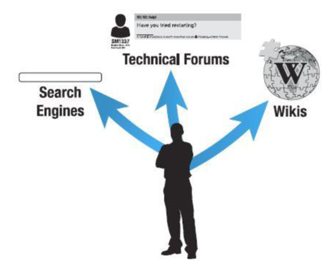

> Figura 1.6 Habilidades de búsqueda

Cada capítulo del libro tiene una actividad al final que te permite practicar la búsqueda de información en internet relacionada con el capítulo. Los consejos para buscar incluyen los siguientes:

- Los motores de búsqueda usan algoritmos distintos, así que si uno no funciona, prueba otro. Ejemplos de motores de búsqueda son Google, Bing, Yahoo y Ask. Para acceder a un motor de búsqueda, abre un navegador web y escribe el nombre de uno de los motores de búsqueda seguido de .com. La Figura 1.7 muestra dónde se escribe el nombre del motor de búsqueda en la barra de direcciones.

- Usa **palabras clave descriptivas**.
- No incluyas palabras comunes como *the*, *in*, *at* o *for*, porque los motores de búsqueda tienden a omitirlas de todos modos. Si de verdad quieres usar una de ellas, pon un signo **+** delante de la palabra.
- Evita usar una versión compleja, el plural o el tiempo pasado de una palabra, para no eliminar páginas relevantes. Por ejemplo, para buscar cómo instalar un auricular Bluetooth, evita usar la palabra *installation*, *installed* o *installing* en la ventana de búsqueda. Simplemente incluye la palabra *install*.
- Si se usan varias palabras juntas (una frase exacta), como *Windows 10*, pon comillas alrededor de la frase: «Windows 10».
- Usa tantas palabras distintivas como sea posible.
- Si dos palabras tienen el mismo significado y ambas son de uso común, usa la palabra **or** (*o*) en la búsqueda. Por ejemplo, para buscar información genérica sobre una impresora matricial, que a veces se llama impresora de impacto (*impact printer*), podrías buscar así: «dot matrix» or «impact printer».
  Ten en cuenta que la barra vertical (**|**), que es la tecla sobre la tecla *Enter*, se puede usar en lugar de la palabra *or*, así: «dot matrix» | «impact printer».
- Si un término en particular puede tener dos significados (como la palabra *memory*, que puede referirse a algo dentro de una computadora o a una función del cerebro), puedes usar el signo menos para evitar que se muestre cierta información. Por ejemplo, **memory -brain** sería una búsqueda de *memory* sin incluir resultados sobre funciones cerebrales.
- Si un término en particular (como *memory*) es genérico, puedes añadir una palabra y usar la palabra **AND** (*y*) para aclarar la búsqueda, como **computer AND memory**.
- Cuando busques información técnica, incluye el fabricante del hardware o del software. Una búsqueda de *Microsoft Windows 10* ofrece resultados distintos a una búsqueda de *Windows 10*.
- Si no hay nada relevante en la primera página de enlaces, cambia las palabras clave de tu búsqueda.

Considera la situación de un teclado que funciona de forma intermitente en una computadora Microsoft Surface. El teclado no viene de serie como parte de la compra de una Surface. Tú no tienes una Surface y no estás familiarizado con la tableta, pero debes darle soporte. Un ejemplo de lo que podrías escribir en un motor de búsqueda es: **Microsoft Surface intermittent keyboard**.

### Capturar la pantalla

A veces, parte de la documentación técnica consiste en ser capaz de capturar lo que hay en la pantalla. Las versiones de Windows incluyen la **Herramienta Recortes** (*Snipping Tool*) y **Recortar y anotar** (*Snip & Sketch*); puedes acceder a estas herramientas manteniendo presionada la tecla **Windows**, presionando y manteniendo la tecla **Mayús** (*Shift*) y presionando la tecla **S**. Esto facilita documentar problemas, y puedes copiar lo que capturas en otras aplicaciones. No importa qué trabajo de IT tengas cuando entres al mercado laboral; la documentación es parte de todos los trabajos de IT.

### Crear un archivo de texto

Otra parte de la documentación puede implicar crear o usar un archivo de texto, conocido como archivo **.txt**. Puede que necesites enviarlo como adjunto o que tengas que crear un archivo de texto como parte del trabajo. A veces un archivo de texto es el tipo de archivo más fácil de crear, especialmente en un dispositivo móvil. Los archivos de texto se pueden crear usando un procesador de textos y el proceso «Guardar como», o se pueden crear con una aplicación. Los archivos de texto son populares porque muchas aplicaciones pueden abrirlos. Los archivos de texto suelen incluir solo texto, sin múltiples fuentes ni gráficos. Windows tiene el **Bloc de notas** (*Notepad*) y Apple tiene **TextEdit**, que se pueden usar para crear o abrir archivos de texto.

## Tipos de computadoras

El lugar más sencillo para empezar a aprender sobre soporte técnico de computadoras son los propios dispositivos. La PC, o computadora personal (*personal computer*), viene en modelos **de escritorio**, **de torre** y **todo-en-uno** (*all-in-one*), además de modelos móviles como portátiles (*laptops*), teléfonos inteligentes (*smartphones*) y tabletas (*tablets*). La Figura 1.8 muestra algunos de los dispositivos informáticos a los que se espera que el personal técnico dé soporte.

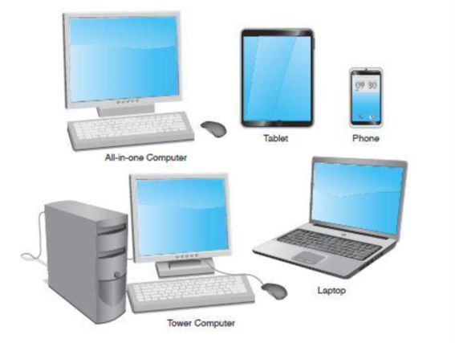

> Figura 1.8 Tipos de computadoras

## Hardware básico de la computadora

Los sistemas informáticos incluyen **hardware**, **software** y **firmware**. El hardware es algo que puedes tocar y sentir, como la computadora física y las partes dentro de ella. El monitor, el teclado y el ratón son componentes de hardware. El software interactúa con el hardware. Windows, Linux, macOS, Microsoft 365, Google Chrome, Adobe Acrobat Reader, Intuit TurboTax y WordPerfect son ejemplos de software.

Sin software que dirija el hardware para lograr algo, una computadora no es más que un tope de puerta. Toda computadora necesita una pieza importante de software llamada **sistema operativo**, que coordina la interacción entre el hardware y las aplicaciones de software. El sistema operativo también gestiona la interacción entre el usuario y la computadora. Ejemplos de sistemas operativos incluyen Windows 10 y 11, macOS y varios sistemas Linux, como Red Hat y Ubuntu.

Un **controlador de dispositivo** (*device driver*) permite que el sistema operativo reconozca, controle y use un componente de hardware. Los controladores de dispositivo son específicos para el hardware y el sistema operativo. Por ejemplo, una impresora requiere un controlador específico cuando se conecta a una computadora que tenía instalado Windows 7. Esa misma impresora podría requerir un controlador distinto al usar Windows 10 u 11. Ese controlador de impresión de Windows no funcionaría en una computadora Apple. Cada pieza de hardware instalada requiere un controlador para el sistema operativo que se esté usando. La Figura 1.9 muestra cómo el hardware y el software deben trabajar juntos.

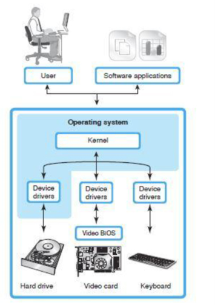

> Figura 1.9 Hardware y software

Observa en la Figura 1.9 el **núcleo** (*kernel*) del sistema operativo. El núcleo es la parte central de un sistema operativo. Es la conexión entre el hardware y las aplicaciones que se están usando.

Una PC normalmente consta de un **gabinete** (*case* o *chassis*), un teclado que permite a los usuarios introducir datos, un monitor que muestra o emite información (que se muestra en la Figura 1.10) y un ratón que permite introducir datos o seleccionar menús y opciones. La Figura 1.10 muestra un monitor de computadora, que también puede llamarse panel plano, pantalla o display.

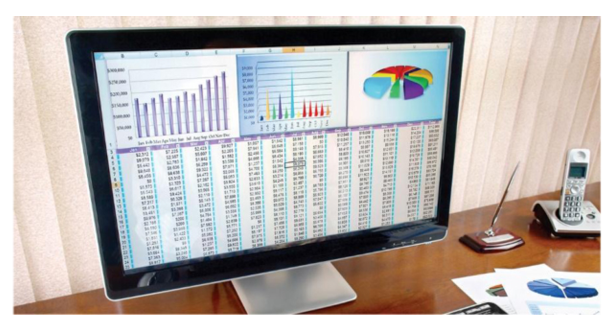

> Figura 1.10 Monitor de computadora

Cuando se abre o se retira la cubierta o el lateral de la computadora, se pueden identificar las partes internas. La parte más fácil de identificar es la **fuente de poder** (*power supply*), que es la caja metálica que normalmente se encuentra en una esquina trasera del gabinete. Un cable de poder conecta la fuente de poder a un tomacorriente de pared o a una regleta. Un propósito de la fuente de poder es convertir el **voltaje AC** del tomacorriente en el **voltaje DC** que se usa internamente en la PC. La fuente de poder distribuye ese voltaje DC mediante cables de poder que se conectan a las distintas partes internas de la computadora. Un ventilador ubicado dentro de la fuente de poder mantiene la computadora fría para evitar daños a los componentes.

Una PC suele tener un dispositivo para almacenar aplicaciones y archivos. Dos ejemplos de dispositivos de almacenamiento son el disco duro y la unidad óptica. El **disco duro** (*hard drive*), a veces llamado *hard disk*, es una caja rectangular normalmente dentro del gabinete de la computadora y sellada para mantener fuera el polvo y la suciedad. El disco duro no tiene apertura externa. Hay que abrir la computadora para acceder a un disco duro interno. Una **unidad óptica** (*optical drive*) aloja discos (discos compactos o CD), discos versátiles digitales (DVD) o discos Blu-ray (BD) que contienen datos, música, video o aplicaciones de software. El frente de la unidad óptica tiene una bandeja que se expulsa hacia afuera para poder insertar un disco. La Figura 1.11 muestra los principales componentes de una computadora de torre. Las Figuras 1.12 a 1.14 muestran componentes tal como se verían antes de instalarse. La Figura 1.12 muestra un disco duro. La Figura 1.13 muestra una unidad óptica. La Figura 1.14 muestra una fuente de poder. La Figura 1.15 muestra un gabinete de torre.

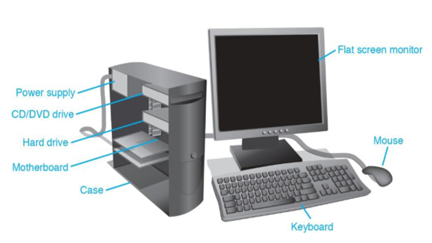

> Figura 1.11 Computadora de torre

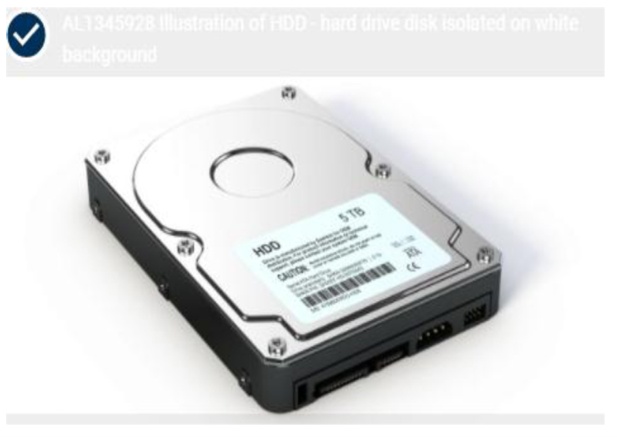

> Figura 1.12 Disco duro

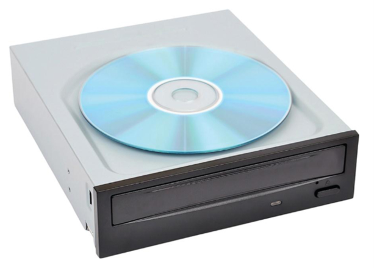

> Figura 1.13 Unidad de DVD u óptica

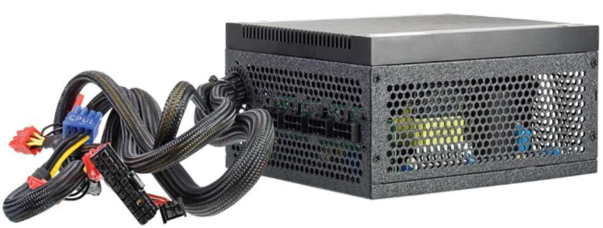

> Figura 1.14 Fuente de poder

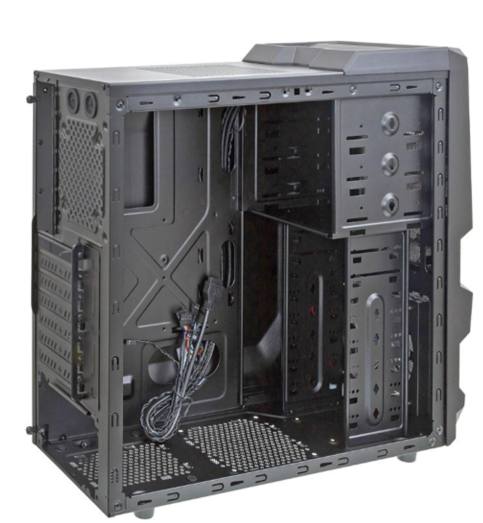

> Figura 1.15 Gabinete de torre

La **placa madre** (*motherboard*) es la placa de circuito principal dentro de una PC y contiene la mayor parte de la electrónica. Normalmente está ubicada en la parte inferior de una computadora de escritorio o portátil y montada a un costado en una computadora de torre. Otros nombres para la placa madre son *mainboard*, *planar* o *system board*. Los dispositivos externos se conectan directamente en la parte trasera de la placa madre o en puertos en la parte delantera de la computadora. La Figura 1.16 muestra una placa madre cuando no está instalada dentro de una computadora, así como la memoria y un adaptador, que se explican a continuación.

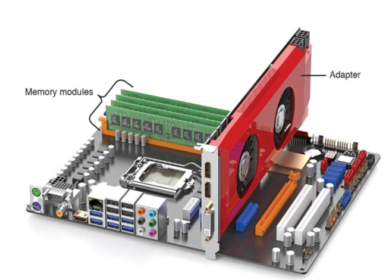

> Figura 1.16 Placa madre de computadora

La placa madre contiene módulos de memoria. Los módulos de memoria guardan las aplicaciones, parte del sistema operativo y los documentos del usuario. La **memoria de acceso aleatorio** (*random-access memory*, RAM) es el tipo de memoria más común en la placa madre y es **volátil**; es decir, los datos del módulo se pierden cuando se corta la energía. Cuando un usuario escribe un documento en un programa de procesamiento de textos, tanto la aplicación de procesamiento de textos como el documento están en la RAM. Si el usuario apaga la computadora sin guardar el documento en un medio extraíble o en el disco duro, el documento se pierde porque la información no permanece en la RAM. (Ten en cuenta que algunas aplicaciones pueden guardar un documento periódicamente, pero eso no garantiza que tenga la información más reciente.) La Figura 1.17 muestra módulos de memoria cuando no están instalados en las ranuras de memoria de la placa madre. La memoria se cubre con gran detalle en el Capítulo 6, «Memoria».

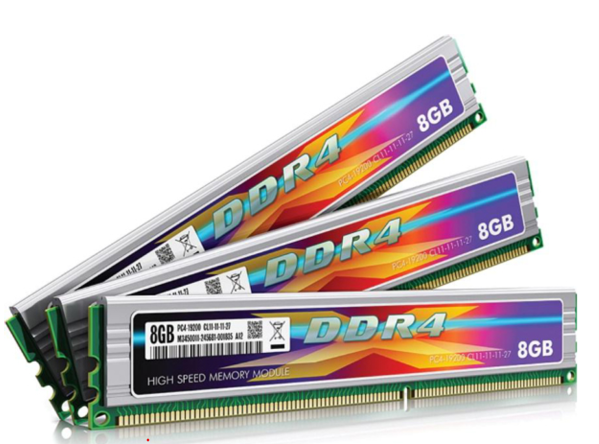

> Figura 1.17 Módulos de memoria

Un dispositivo puede tener un cable que lo conecta a la placa madre. Otros dispositivos requieren un **adaptador** (*adapter*). Un adaptador es una tarjeta electrónica que se inserta en una **ranura de expansión** (*expansion slot*) de la placa madre. Otros nombres para un adaptador son controlador (*controller*), tarjeta (*card*), tarjeta controladora (*controller card*), tarjeta de circuito (*circuit card*), placa de circuito (*circuit board*) y placa adaptadora (*adapter board*). Los adaptadores permiten agregar funcionalidad o una mejora que no se proporciona a través de los puertos de la placa madre, como mejor sonido o gráficos de video, o puertos adicionales de algún tipo para conectar dispositivos externos. La Figura 1.18 muestra un adaptador. Observa cómo los contactos de la parte inferior tienen una forma particular. El Capítulo 3, «En la placa madre», entra en más detalle sobre los tipos de ranuras de expansión y adaptadores. También puedes volver a la Figura 1.16 para ver una tarjeta/adaptador de video instalada en una ranura de expansión de la placa madre.

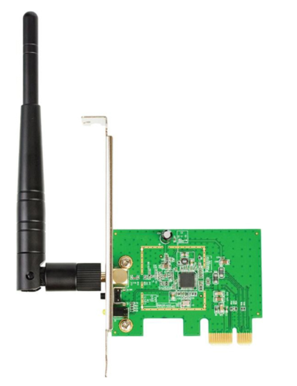

> Figura 1.18 Adaptador

### Consejo técnico: cómo identificar la función de un adaptador

Seguir el cable conectado a un adaptador o mirar el dispositivo conectado a él puede ayudar a identificar la función del adaptador.

Los siguientes son los pasos generales para instalar adaptadores:

1. Sigue siempre las instrucciones de instalación del fabricante. Usa una **pulsera antiestática** al manipular adaptadores. La **descarga electrostática** (*electrostatic discharge*, ESD) puede dañar las piezas electrónicas. (Consulta el Capítulo 5, «Desarmado y energía», para más detalles sobre ESD.)
2. Asegúrate de que la computadora esté apagada y desenchufada.
3. Retira los soportes del gabinete o las cubiertas plásticas de la parte trasera de la computadora que puedan impedir la instalación del adaptador. Instala el adaptador en una ranura de expansión libre y vuelve a colocar cualquier herraje de sujeción.
4. Conecta los cables internos que van al adaptador, así como los cables que van a un puerto externo del adaptador.
5. Conecta los dispositivos internos o externos a los extremos opuestos del cable, si es necesario.
6. Enciende los dispositivos externos conectados al adaptador, si corresponde.
7. Vuelve a conectar el cable de poder de la computadora y enciende la computadora.
8. Carga el software de aplicación o los controladores necesarios para los dispositivos conectados al adaptador.
9. Prueba el dispositivo conectado al adaptador.

Consulta la Figura 1.19 para ver una ilustración de una placa madre, ranuras de expansión, memoria y un adaptador en una ranura de expansión.

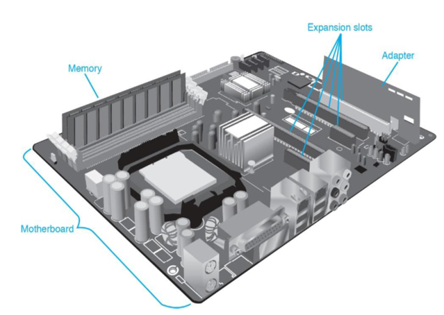

> Figura 1.19 Placa madre con ranuras de expansión y un adaptador

## Ratones y teclados

Los dispositivos de entrada, como el ratón y el teclado, se conectan a la placa madre. El tipo de ratón más común es el **ratón óptico** (*optical mouse*), que tiene sensores ópticos que detectan la dirección en la que se mueve el ratón. Usa reflejos de diodos emisores de luz (*light-emitting diodes*, LED) sobre casi cualquier superficie para detectar la ubicación del ratón. Comúnmente se puede ajustar la **sensibilidad** del ratón: cuánto hay que moverlo para desplazar el cursor en la pantalla la cantidad deseada. La Figura 1.20 muestra una foto de la parte inferior de un ratón óptico.

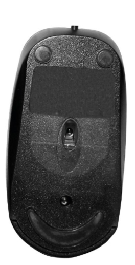

> Figura 1.20 Ratón óptico

Un **teclado** (*keyboard*) es un dispositivo de entrada que se conecta a un puerto de la placa madre o se conecta de forma inalámbrica. Entre las características que los usuarios buscan en un teclado están un teclado numérico separado (para quienes tienen que introducir muchos números), patas de inclinación ajustables y resistencia a derrames. La Figura 1.21 muestra el tipo de teclado y ratón que se usan comúnmente con una computadora de torre, de escritorio o todo-en-uno.

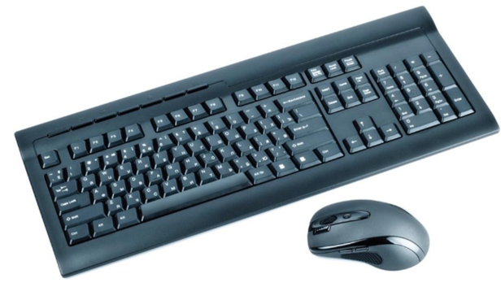

> Figura 1.21 Teclado y ratón

### Mantenimiento preventivo de ratones y teclados

En las tiendas de computadoras hay kits de limpieza de ratón, pero los productos de limpieza domésticos normales también funcionan. Usa los siguientes procedimientos para limpiar un ratón óptico:

1. Limpia la parte inferior con un paño húmedo y sin pelusa.
2. Usa aire comprimido para limpiar los sensores ópticos.

Los teclados también necesitan limpieza periódica. La Figura 1.22 muestra técnicas de limpieza de teclados.

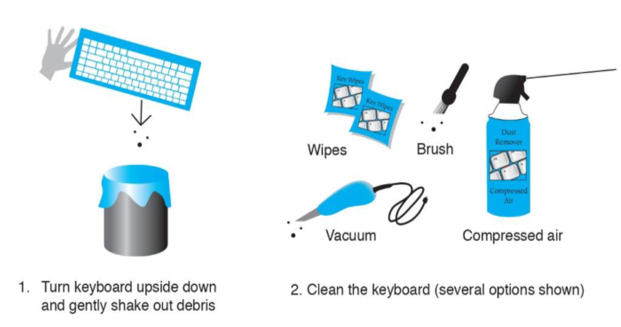

> Figura 1.22 Técnicas de limpieza de teclado

### Solución de problemas de teclado y ratón

Una de las formas más fáciles de determinar si un teclado funciona es presionar la tecla **Bloq Mayús** (*Caps Lock*) o **Bloq Num** (*Num Lock*) y observar si se ilumina la luz del teclado. A veces, un ajuste de una aplicación puede causar lo que parece un problema de teclado. Usa otra aplicación para ver si el teclado es el problema. Los teclados pueden tener luces LED que indican funciones concretas. La Tabla 1.3 enumera las más comunes. Ten en cuenta que distintos fabricantes etiquetan las luces de diversas maneras.

> Tabla 1.3 Luces comunes del teclado

| Tecla de alternancia asociada | Luz del teclado | Descripción |
|---|---|---|
| Bloqueo numérico (NUM LOCK) | Bloqueo de números | Alterna el teclado numérico de 10 teclas entre los dígitos del 0 al 9 y varias funciones, como HOME, AV PÁG (PG UP), RE PÁG (PG DOWN), FIN (END) y varias teclas de flecha. |
| Bloqueo de mayúsculas (CAPS LOCK) | Bloqueo de letras mayúsculas | Alterna entre todas las letras en mayúsculas y en minúsculas. |
| Bloqueo de desplazamiento (SCROLL LOCK) | Bloqueo de desplazamiento | Una tecla rara vez usada que sirve para impedir el desplazamiento y el uso de las teclas de flecha para avanzar por la información mostrada. |

### Consejo técnico: una tecla no funciona

Si una tecla en particular no funciona bien, retira el capuchón de la tecla. Un destornillador pequeño de punta plana puede ayudarte con esto. Después de retirar el capuchón, usa aire comprimido alrededor de la tecla pegajosa o que no funciona.

Si se derrama café u otro líquido dentro de un teclado de PC, no todo está perdido, pero desenchúfalo rápidamente y lejos de la computadora, y voltéalo. Usa toallas de papel para absorber toda el agua que puedas. Después, el teclado se puede desarmar o frotar con hisopos o paños sin pelusa. Sin embargo, los teclados y ratones de PC normalmente se consideran **tecnología desechable**: sale más barato comprar uno nuevo que dedicar mucho tiempo a intentar reparar un teclado o un ratón.

## Periféricos comunes

Muchos dispositivos se conectan a una computadora para proporcionar **entrada**, como un ratón o un teclado, o **salida**, como una pantalla. Algunos dispositivos pueden ser tanto de entrada como de salida, como los televisores inteligentes, los dispositivos habilitados para **MIDI** (*Musical Instrument Digital Interface*, que son dispositivos musicales electrónicos), las pantallas táctiles o las impresoras. En el caso de una impresora, los datos se envían de la computadora a la impresora, y la impresora puede enviar datos (información), como un mensaje de «sin tinta», de vuelta a la computadora. La Figura 1.23 muestra algunos dispositivos de entrada y salida comunes.

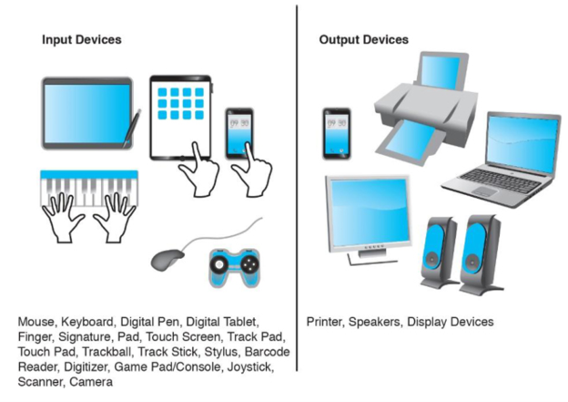

> Figura 1.23 Dispositivos de entrada y salida

La Tabla 1.4 enumera varios periféricos que verás usados y conectados a las computadoras hoy en día. Examinaremos algunos de estos dispositivos con más profundidad y aprenderemos a configurarlos, pero este es un buen capítulo para aprender lo básico.

> Tabla 1.4 Periféricos comunes

| Periférico | Descripción |
|---|---|
| Impresora | Un dispositivo de salida que transfiere información, como texto y gráficos, desde una computadora a papel u otro medio (ver Figura 1.24). |
| Escáner de superficie plana | Un dispositivo de entrada que digitaliza palabras o gráficos y se puede usar como copiadora. Un escáner puede tener un alimentador automático de documentos (ADF) que permite introducir uno o más documentos en el escáner (ver Figura 1.24). |
| Impresora todo-en-uno | Un dispositivo que tiene funciones de impresora, escáner y copiadora, y a veces de fax. A veces se conoce como impresora multifunción (ver Figura 1.24). |
| Cámara/webcam | Un dispositivo de entrada que se usa para proporcionar una transmisión de video en vivo, como cuando participas en una videoconferencia, o para capturar imágenes o movimiento de video (ver Figura 1.25). Se puede encontrar más información en el Capítulo 8, «Video and Multimedia Devices». |
| Micrófono | Un dispositivo de entrada que se usa para capturar sonido (ver Figura 1.25). Se puede encontrar más información en el Capítulo 8. |
| Auricular con micrófono (headset) | Un dispositivo de entrada/salida que comúnmente tiene un micrófono y auriculares, como se muestra en la Figura 1.25. |

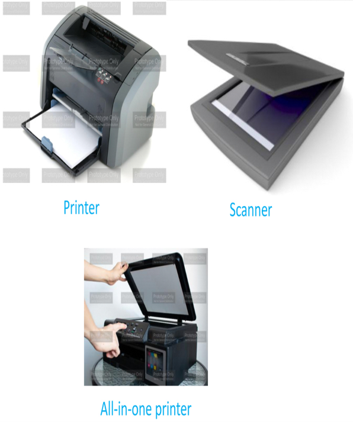

> Figura 1.24 Impresora, escáner e impresora todo-en-uno

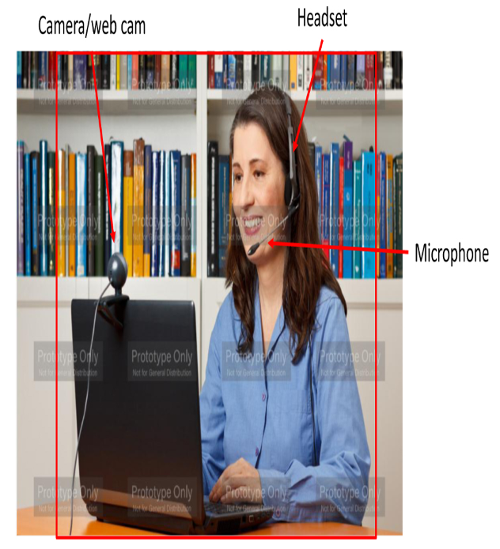

> Figura 1.25 Cámara/webcam, auriculares con micrófono y micrófono

## Los 1s y 0s

Las computadoras son dispositivos digitales. Eso significa que entienden **1s y 0s**. Un 1 o un 0 se conoce como **bit**. En realidad, un 1 es simplemente un nivel de voltaje. Así, cuando escribimos caracteres en una aplicación de procesamiento de textos, el teclado traduce esos caracteres a niveles de voltaje. La Figura 1.26 muestra este concepto. Observa que cada letra se representa mediante una combinación de ocho 1s y 0s. Cada 1 es un nivel de voltaje enviado a la placa madre (y a los componentes de ella). Cada 0 es simplemente la ausencia de un nivel de voltaje.

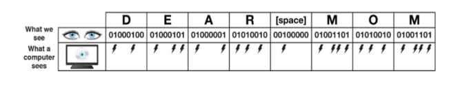

> Figura 1.26 Bits binarios

Los técnicos necesitan poder describir capacidades como la capacidad de un disco duro y el espacio disponible en la unidad. Ocho bits agrupados son un **byte**. La Figura 1.27 muestra un «hot dog» dividido en ocho secciones (que forman un gran «byte»).

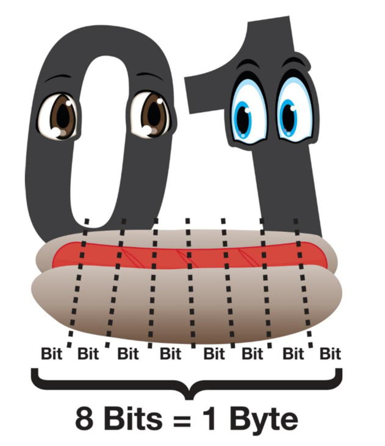

> Figura 1.27 Un byte

Aproximadamente 1000 bytes son un **kilobyte** (kB), como se muestra en la Figura 1.28. Para ser exactos, 1 kB son 1024 bytes, pero la gente de la industria simplemente redondea el número al millar más cercano para facilitar los cálculos. Aproximadamente 1 millón de bytes es un **megabyte** (MB), pero un megabyte real es 1 048 576 bytes. 540 megabytes se abrevian 540 MB, o 540 M. Observa en la Figura 1.29 que un megabyte almacena muchos más 1s y 0s que un kilobyte.

Aproximadamente 1 000 millones de bytes (1 073 741 824 bytes) es un **gigabyte** (GB), que se muestra como 1 GB o 1 G. Aproximadamente 1 billón de bytes (1 099 511 627 776 bytes) es un **terabyte**, que se muestra como 1 TB o 1 T. Las Figuras 1.30 y 1.31 muestran cómo las capacidades de almacenamiento se vuelven más grandes.

Cuando la información necesita expresarse con exactitud, se usan los **prefijos binarios**. Por ejemplo, al describir el valor 2^10 (1024), en lugar de decir que es 1 kilobyte, que la gente tiende a pensar como aproximadamente 1000 bytes, se usa el término **kibibyte** (KiB). Al describir el valor 2^20, o 1 048 576, se usa el término **mebibyte** (MiB). La Tabla 1.5 muestra los términos usados con la capacidad de almacenamiento de la computadora y los prefijos binarios cuando se necesitan medidas exactas.

> Tabla 1.5 Términos de almacenamiento y prefijos binarios

| Término | Abreviatura | Descripción |
|---|---|---|
| Kilobyte / kibibyte | kB / KiB | ~1 mil bytes / 2^10 bytes |
| Megabyte / mebibyte | MB / MiB | ~1 millón de bytes / 2^20 bytes |
| Gigabyte / gibibyte | GB / GiB | ~1000 millones de bytes / 2^30 bytes |
| Terabyte / tebibyte | TB / TiB | ~1 billón de bytes / 2^40 bytes |
| Petabyte / pebibyte | PB / PiB | ~1000 billones de bytes / 2^50 bytes |
| Exabyte / exbibyte | EB / EiB | ~1 trillón de bytes / 2^60 bytes |
| Zettabyte / zebibyte | ZB / ZiB | ~1000 exabytes / 2^70 bytes |
| Yottabyte / yobibyte | YB / YiB | ~1 millón de exabytes / 2^80 bytes |

Las **frecuencias** también son mediciones importantes en las computadoras, porque la gente quiere saber qué tan rápido funcionan sus computadoras, procesadores, memoria y otras partes. Las frecuencias se muestran con mediciones similares, pero en lugar de bits (b) o bytes (B), las velocidades se muestran en **hertz** (Hz). Un hertz es una medición de ciclos por segundo. Algo que funciona a aproximadamente 1 millón de ciclos por segundo se dice que funciona a 1 **megahertz** (1 MHz). Para 1000 millones de ciclos por segundo, la medición se conoce como 1 **gigahertz**, o 1 GHz.

Las velocidades de transferencia comúnmente se muestran en bits por segundo, como **gigabits por segundo** o Gb/s, o en bytes por segundo, como en **megabytes por segundo** o MB/s. Observa la letra **B** mayúscula para indicar bytes frente a la **b** minúscula para indicar bits. Estas mediciones se usan en gran cantidad de hardware y software relacionados con IT.

## Notas de seguridad

La seguridad se trata en cada capítulo, especialmente en el Capítulo 5, pero ningún libro sobre reparación de computadoras puede comenzar sin afirmar que tanto el técnico como la computadora pueden resultar dañados por malos hábitos de seguridad. Antes de comenzar cualquier servicio de PC, quítate las joyas. Para protegerte a ti y a la computadora, asegúrate de apagar la computadora y retirar el cable de poder al desarmar, instalar o retirar hardware, o al hacer mantenimiento preventivo (limpieza).

### Consejo técnico: algunas cosas deben dejarse en paz

Nunca desarmes un monitor antiguo de **tubo de rayos catódicos** (*cathode ray tube*, CRT) ni una fuente de poder, a menos que te hayan capacitado específicamente sobre estos componentes.

Los técnicos también pueden resultar dañados al hacer tareas físicas como levantar una computadora o una impresora láser pesada. El levantamiento de peso es un requisito común que aparece en los anuncios de empleo de IT y que se explica durante las entrevistas. Los trabajos técnicos con frecuencia especifican un requisito máximo de levantamiento de 40 a 50 libras (18 a 22 kg). Usa las precauciones de seguridad adecuadas, como las que se muestran en la Figura 1.32. El tipo de equipo que necesitas y las cosas que puedes hacer para evitar dañar la computadora se cubren con más detalle en el Capítulo 5, sobre energía y desarmado.

## Resumen del capítulo

- Muchos roles de IT requieren un conocimiento detallado del hardware y el software de PC.
- Los técnicos en computadoras deben escuchar activamente, tener una actitud positiva y usar la lógica al resolver problemas.
- La certificación CompTIA A+ requiere dos exámenes: Core 1 (220-1101) y Core 2 (220-1102). Muchas personas entran al campo de IT con esta certificación.
- El personal de IT debe ser competente en buscar información en internet, capturar archivos y documentar información técnica.
- Las computadoras constan de hardware (las partes físicas) y software (el sistema operativo y las aplicaciones).
- Un técnico necesita ser capaz de identificar las partes importantes de la computadora instaladas en ella y como piezas sueltas: gabinete, teclado, ratón, placa madre, monitor, fuente de poder, disco duro, unidad óptica, adaptador y memoria.
- Un técnico necesita conocer los propósitos de los periféricos comunes usados en la industria: impresora, escáner plano con ADF, cámara/webcam, micrófono y auriculares con micrófono.
- Los ratones y teclados son dispositivos de entrada importantes. Para limpiar un teclado, voltéalo para retirar la basura. Luego usa una aspiradora, aire comprimido o toallitas para limpiarlo.
- La seguridad es importante al trabajar en una computadora. Apágala y retira el cable de poder antes de trabajar dentro de ella.
- Usa técnicas de levantamiento adecuadas al dar servicio a los equipos.

### Consejos para el examen de certificación A+

- Duerme bien la noche anterior al examen.
- Asegúrate de conocer a fondo y dominar todos los términos y tecnologías enumerados en los objetivos oficiales del examen CompTIA A+. Algunos estudiantes estudian para un examen concreto repasando los objetivos uno por uno y revisando el material a medida que avanzan.
- Asegúrate de poder identificar las partes básicas de una computadora y explicar el propósito de cada una. Asegúrate de conocer las siguientes partes: disco duro, unidad óptica, fuente de poder, placa madre y RAM.
- Conoce el hardware común para que estés familiarizado con los capítulos futuros que entran en detalle sobre cómo instalarlo, configurarlo y solucionar sus problemas: impresora, escáner plano, ADF, monitor, unidad óptica, ratón, teclado, *trackpad*, tableta de dibujo, cámara/webcam, micrófono, parlantes y auriculares con micrófono.
- Conoce los siguientes procedimientos de seguridad: desconectar la energía, quitarse las joyas, técnicas de levantamiento y límites de peso.
- Repasa la sección «Habilidades blandas» al final del capítulo. Asegúrate de saber qué son las preguntas abiertas.

## Términos clave

- Habilidades de escucha activa — *active listening skills*
- Adaptador — *adapter*
- ADF — *automatic document feeder* (alimentador automático de documentos)
- Bit — *bit*
- Byte — *byte*
- Cámara — *camera*
- Aclarar las declaraciones del cliente — *clarify customer statements*
- Controlador de dispositivo — *device driver*
- Ranura de expansión — *expansion slot*
- Escáner plano — *flatbed scanner*
- Gigabyte — *gigabyte*
- Disco duro — *hard drive*
- Hardware
- Auriculares con micrófono — *headset*
- Teclado — *keyboard*
- Kilobyte — *kilobyte*
- Megabyte — *megabyte*
- Memoria — *memory*
- Micrófono — *microphone*
- Monitor
- Placa madre — *motherboard*
- Ratón — *mouse*
- Pregunta abierta — *open-ended question*
- Sistema operativo — *operating system*
- Unidad óptica — *optical drive*
- PC
- Fuente de poder — *power supply*
- Impresora — *printer*
- RAM
- Software
- Terabyte — *terabyte*
- Webcam — *webcam*

## Preguntas de repaso

1. Empareja cada parte con la descripción correspondiente.
   - ____ placa madre — a. Convierte AC en DC
   - ____ RAM — b. Almacena la mayor cantidad de datos
   - ____ unidad de DVD — c. Tiene la mayor cantidad de electrónica
   - ____ disco duro — d. Encaja en una ranura de expansión
   - ____ adaptador — e. Su contenido desaparece cuando se corta la energía
   - ____ fuente de poder — f. Aloja un disco

2. A un técnico se le ha pedido dar soporte a un asistente administrativo que participa en una sesión de videoconferencia. ¿Qué periférico se usaría en videoconferencia más que en las tareas operativas diarias normales?
   [ ratón | webcam | impresora todo-en-uno | disco duro ]

3. ¿Cuáles de los siguientes son consejos importantes sugeridos para la búsqueda en internet? (Elige dos.)
   a. Prueba otro motor de búsqueda si el primero no da resultados satisfactorios.
   b. Usa tantas palabras comunes como sea posible, como *the*, *in*, *at* o *for*.
   c. Pon comillas alrededor de dos o más palabras que puedan aparecer consecutivamente en los resultados.
   d. Usa la menor cantidad de palabras posible.
   e. Evita usar el nombre del fabricante del equipo.

4. ¿Cuál es el acrónimo que se usa para describir la memoria que comúnmente se encuentra en una placa madre?

5. Al levantar una computadora pesada, debes agacharte, doblar las rodillas y usar las piernas para levantarla. [ V | F ]

6. ¿Cuántos exámenes debe presentar una persona para estar certificada A+?
   [ 0 | 1 | 2 | 3 | 4 ]

7. ¿La siguiente pregunta es abierta o cerrada? «Dices que tu computadora ha estado funcionando lentamente desde el lunes. ¿Qué aplicaciones instalaste esta semana?»
   [ abierta | cerrada ]

8. Menciona un ejemplo de tener una actitud positiva.

9. ¿Cuáles de los siguientes dispositivos son dispositivos de salida comunes? (Selecciona todos los que correspondan.)
   [ piano digital | parlantes | pantalla | lápiz óptico (*stylus*) | *track stick* | lector de códigos de barras | impresora ]

10. ¿Cuántas libras se podría esperar que levanten las personas que trabajan con computadoras?
    [ 10 a 20 | 20 a 30 | 30 a 40 | 40 a 50 ]

11. ¿Qué aplicación de Microsoft Windows podría usarse para crear un archivo de texto?
    [ Textpad | Bloc de notas | WriteIt | NoteIt ]

12. ¿Qué herramienta de Windows puede usarse para capturar la pantalla?
    [ Bloc de notas | Bluetooth | Microsoft Edge | Recortar y anotar ]

13. Reescribe la siguiente conversación como una pregunta abierta.
    Técnico: Buenos días. Tengo un registro de servicio que indica que recibe un mensaje de error cada vez que accede a un archivo PDF. ¿Ha hecho sus actualizaciones de Acrobat últimamente?

14. Menciona un procedimiento que harías para ayudar con un ratón óptico errático.

15. Empareja la capacidad con la descripción.
    - ____ bit — a. 8 bits
    - ____ kilobyte — b. un 1 o un 0
    - ____ megabyte — c. aproximadamente 1000 bytes
    - ____ byte — d. aproximadamente 1 millón de bytes
    - ____ gigabyte — e. aproximadamente 1 billón de bytes
    - ____ terabyte — f. aproximadamente 1000 millones de bytes

16. Empareja el dispositivo con la descripción. Ten en cuenta que cada descripción encaja mejor con una sola respuesta.
    - ____ escáner plano — a. tiene un ADF
    - ____ adaptador — b. se usa para alimentar varias hojas de papel, una página a la vez
    - ____ ADF — c. se usa para capturar video
    - ____ fuente de poder — d. se inserta en una ranura de expansión
    - ____ webcam — e. convierte AC en DC

17. ¿Cuál de las siguientes es una característica de un ratón óptico?
    a. LED
    b. contactos
    c. volatilidad
    d. conversión eléctrica

18. ¿Qué dispositivo se encuentra normalmente dentro de una computadora?
    [ ADF | impresora | auriculares con micrófono | disco duro ]

19. ¿Qué dispositivo normalmente se puede ver al mirar dentro de una computadora de escritorio con la cubierta retirada y al mirar normalmente la parte delantera de una computadora de escritorio?
    [ disco duro | placa madre | unidad óptica | RAM ]

20. ¿Dónde puedes encontrar la placa madre en una computadora de torre?
    a. dentro de la fuente de poder
    b. a un costado del gabinete
    c. debajo del disco duro
    d. al lado de la RAM

## Ejercicios

### Ejercicio 1.1 Identificar las partes de una computadora de torre

**Objetivo:** Identificar correctamente varias partes de la computadora.

**Procedimiento:** Identifica cada parte de la computadora en la Figura 1.33. Empareja la parte con el número en la Figura 1.34.

> Figura 1.33 Identificación de las partes de una computadora de torre

1. ______________________________________________________
2. ______________________________________________________
3. ______________________________________________________
4. ______________________________________________________
5. ______________________________________________________
6. ______________________________________________________
7. ______________________________________________________
8. ______________________________________________________
9. ______________________________________________________

> Figura 1.34 Segunda identificación de las partes de una computadora de torre

1. __________ a. Placa madre
2. __________ b. RAM
3. __________ c. Fuente de poder
4. __________ d. Ventilador del gabinete
5. __________ e. Adaptador
6. __________ f. Unidad óptica
7. __________ g. Gabinete

### Ejercicio 1.2 Identificar las partes de la computadora

**Objetivo:** Identificar correctamente varias partes de la computadora.

**Procedimiento:** Identifica cada parte de la computadora en la Figura 1.35.

> Figura 1.35 Identificación de las partes de la computadora

1. ______________________________________________________
2. ______________________________________________________
3. ______________________________________________________
4. ______________________________________________________
5. ______________________________________________________
6. ______________________________________________________
7. ______________________________________________________
8. ______________________________________________________
9. ______________________________________________________
10. ________

## Actividades

### Descubrimiento en internet

**Objetivo:** Obtener información específica de internet sobre una computadora o sus partes asociadas.

**Materiales:** Computadora con acceso a internet.

**Procedimiento:** Usando internet, localiza información técnica sobre una computadora. Responde las siguientes preguntas según la información recuperada. Ten en cuenta que quizá necesites abrir más de un documento para responder las preguntas.

**Preguntas:**

1. ¿Cuál es el nombre de la computadora para la que encontraste información técnica?
2. ¿Cuánta RAM trae la computadora? (Las respuestas dependen de la computadora.)
3. ¿Qué URL usaste para encontrar esta información?
4. ¿Qué término(s) de búsqueda usarías para el siguiente escenario? Una computadora HP con Windows 10 tiene conectada una impresora láser Samsung ML-2160. Esta impresora admite impresión tanto cableada como inalámbrica. La computadora conectada por cable a la impresora imprime sin problemas, pero ningún dispositivo inalámbrico de la casa puede acceder a la impresora ni siquiera verla.
5. ¿Qué término(s) de búsqueda usarías en un motor de búsqueda para ayudar a un amigo que eliminó accidentalmente un archivo en una computadora con Windows 10?
6. ¿Qué términos de búsqueda usarías para encontrar un video que te muestre cómo agregar una aplicación a una computadora de escritorio con Windows 10?

### Habilidades blandas

**Objetivo:** Mejorar y afinar la capacidad de un futuro técnico para escuchar, comunicarse de forma escrita y oral, y apoyar de manera profesional a las personas que usan computadoras.

**Procedimiento:**

1. En un entorno de equipo, enumera tres cualidades que son importantes en un técnico de computadoras. Crea escenarios que demuestren estas cualidades. Comparte estos hallazgos con la clase de forma clara y concisa.
2. En un entorno de equipo, enumera tres cualidades que no son buenas prácticas para los técnicos de computadoras. Crea escenarios que demuestren estas cualidades. Comparte estos hallazgos con la clase de forma clara y concisa.

### Habilidades de pensamiento crítico

**Objetivo:** Analizar y evaluar información, así como aplicar la información aprendida a situaciones nuevas o diferentes.

**Procedimiento:**

1. Encuentra un anuncio de una computadora en un folleto de computadoras local, un periódico, una revista, un libro o internet. Enumera los componentes que conoces en una columna y los componentes que no conoces en otra columna. Selecciona un componente que no conozcas e investígalo. En una hoja aparte, escribe una descripción del componente, basada en tu investigación, y luego compártela con al menos otra persona. Escribe el nombre de la persona con quien la compartiste.
2. ¿Por qué crees que muchos componentes de computadora se consideran tecnología «desechable»? Enumera tu razonamiento. En grupos de tres o cuatro, comparte tus ideas. Nombra a un portavoz para compartir la reacción de tu grupo en dos oraciones o menos.
3. Un dispositivo promociona una velocidad de transferencia de 1 Gb/s, mientras que otro anuncia 100 MB/s. Compara las velocidades de transferencia de los dos dispositivos e indica cuál es más rápido. Localiza un componente que tengas o que te gustaría tener. Compara productos prestando especial atención a la velocidad de transferencia. Documenta tus hallazgos.
