# Capítulo 2. Conectividad

> Traducción al español del Capítulo 2 («Connectivity») de *Complete A+ Guide to IT Hardware and Software: CompTIA A+ Exams 220-1101 & 220-1102* (Cheryl A. Schmidt, Christopher Lee) — material de estudio de uso personal.
>
> Nota: las figuras y las tablas del libro son imágenes y no se incluyen aquí; se conserva su leyenda traducida como referencia.

En este capítulo aprenderás:

- Los propósitos de los diversos puertos de la computadora
- Qué hacer si no tienes un puerto en particular
- Qué tipos de dispositivos se conectan a puertos específicos
- Diferentes tipos de conectores y cables

**Objetivos del examen CompTIA:**

- 1101-3.1 Explicar los tipos básicos de cables y sus conectores, características y propósitos.
- 1101-3.4 Dado un escenario, instalar y configurar placas madre, unidades centrales de procesamiento (CPU) y tarjetas adicionales.
- 1102-4.7 Dado un escenario, usar técnicas de comunicación y profesionalismo adecuados.

## Introducción a la conectividad

Ahora que hemos hablado de las partes básicas de una PC, estamos listos para adentrarnos en los detalles técnicos. Algunos de los puertos pueden ser complicados al principio, pero es importante que las personas que entran al campo de la IT sepan cómo conectar dispositivos a los puertos y cuál es el propósito de cada puerto.

## Conectividad externa

Un **puerto** (*port*) es un conector en una placa madre o en un adaptador separado que permite conectar un dispositivo a una computadora. Los puertos se pueden encontrar por todos lados en una computadora o dispositivo móvil. La Figura 2.1 muestra una placa madre con algunos de los puertos que cubriremos. Mira cuántos puedes identificar ya y luego vuelve a esta figura al terminar el capítulo. Los profesionales de IT deberían poder reconocer e identificar los puertos comunes que se usan hoy en día.

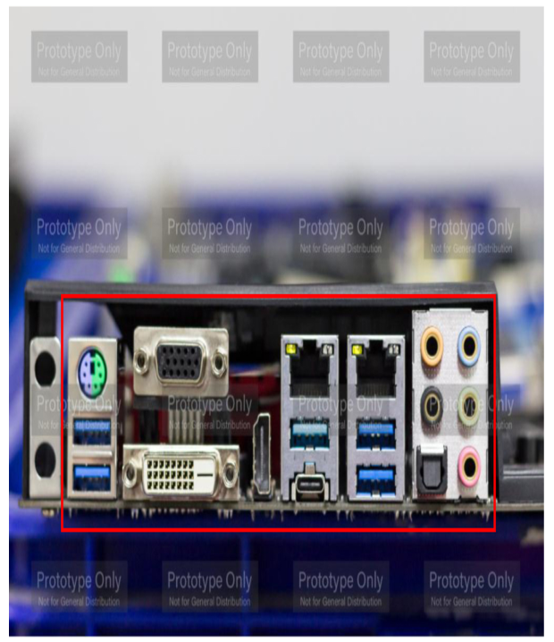

> Figura 2.1 Puertos de la placa madre

### Puertos de ratón y teclado

Los puertos de ratón y de teclado eran tradicionalmente puertos mini-DIN de 6 pines, que a veces se llaman **puertos PS/2**. La mayoría de los puertos tienen una guía (*keyed*) para que el cable solo se pueda insertar de una manera. Hoy en día, los puertos USB se usan más comúnmente para conectar ratones y teclados, pero algunas placas madre para *gaming* todavía tienen el o los puertos mini-DIN. Los fabricantes codifican por colores el puerto del ratón como verde y el del teclado como púrpura; pueden colocar un pequeño diagrama de un teclado o un ratón junto a cada conector. La Figura 2.1 muestra las opciones de conectividad de ratón y teclado.

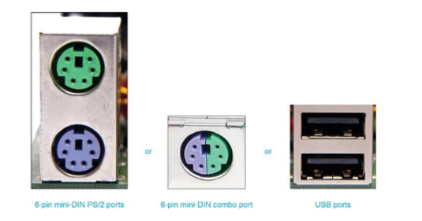

> Figura 2.2 Puertos de ratón y teclado

### Puertos de video

Un **puerto de video** (*video port*) se usa para conectar un monitor. La salida de video puede ser el método más antiguo de una **señal analógica** (niveles variables, como los que se ven en una señal de audio) o la salida más nueva que usa una **señal digital** (1s y 0s). Debido a que una computadora usa señales digitales, enviar 1s y 0s es más eficiente que convertir una señal analógica a una digital. Esto es relevante porque todavía existen puertos de video diseñados para señales analógicas. La Figura 2.3 muestra la diferencia entre señales analógicas y digitales.

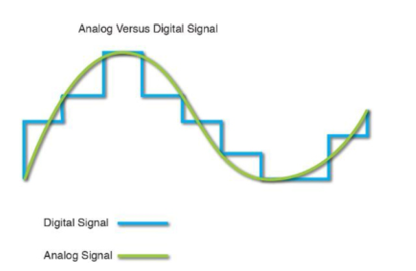

> Figura 2.3 Señales analógicas y digitales

Los puertos de video más comunes que se usan hoy en día son VGA, DVI, DisplayPort y HDMI. Todos se cubren en esta sección. Además, los puertos multipropósito como USB-C, Thunderbolt y Lightning también se usan para video. Los puertos multipropósito se cubren por separado, ya que pueden transmitir más que solo audio y video.

#### Video Graphics Array (VGA)

El puerto **video graphics array**, o **puerto VGA**, se diseñó para salida analógica hacia un monitor antiguo de **tubo de rayos catódicos** (CRT). Los puertos VGA son fáciles de identificar porque tienen tres filas de agujeros, 15 agujeros en total. Los puertos que tienen agujeros se conocen como **puertos hembra**. En la documentación, el puerto VGA a veces aparece como HD15, DE15 o D-sub. La «D» en estos nombres proviene de que el conector VGA es un conector de tipo *D-shell*. Observa el puerto VGA en la Figura 2.4 e imagina ese puerto girado de lado para que parezca la letra D. El cable VGA tiene un extremo macho DB15 que se conecta al puerto hembra DE15.

#### Digital Visual Interface (DVI)

Un puerto más nuevo es el **Digital Visual Interface**, o **puerto DVI**, que tiene tres filas de agujeros cuadrados. Algunos monitores también pueden conectarse al puerto VGA más antiguo. Algunos adaptadores de video también permiten conectar un dispositivo de video (como un televisor) que tenga un **puerto S-Video**. La Figura 2.4 muestra un adaptador de video con el puerto DVI como conector izquierdo, el puerto S-Video en el centro y un puerto VGA a la derecha.

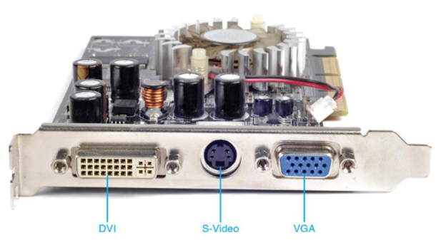

> Figura 2.4 Puertos DVI, S-Video y VGA

Hay varios tipos de conectores DVI. El que se use depende del tipo de monitor conectado. Dos términos usados con estos conectores DVI son *single link* y *dual link*. Una conexión *single link* permite resoluciones de video más bajas que una conexión *dual link*, porque un puerto *dual link* tiene más pines. Los dos tipos principales de conectores son **DVI-D** y **DVI-I**. DVI-D se usa solo para conectividad de video digital. DVI-I se puede usar tanto para monitores digitales como analógicos, y es el más común. Un tipo menos común es **DVI-A**, que se usa para conectividad analógica (y no se muestra en la Figura 2.5). La Figura 2.6 muestra tanto un cable DVI como un cable VGA.

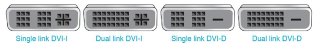

> Figura 2.5 Conectores DVI

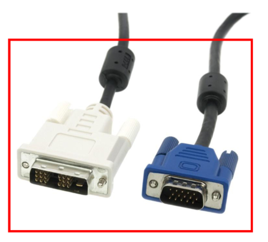

> Figura 2.6 Cables DVI y VGA

##### Consejo técnico: empareja el monitor con el tipo de puerto

Ten cuidado al instalar un monitor. Por ejemplo, asegúrate de que el puerto de video coincida con el tipo de conexión DVI del monitor. Se pueden comprar convertidores para adaptar un monitor a un tipo de puerto diferente.

#### DisplayPort

El **DisplayPort**, desarrollado por VESA (Video Electronics Standards Association), puede enviar y recibir video, audio o ambos tipos de señales simultáneamente hacia monitores, televisores y equipos de cine en casa. La Figura 2.7 muestra el DisplayPort y un cable que se conectaría a este puerto.

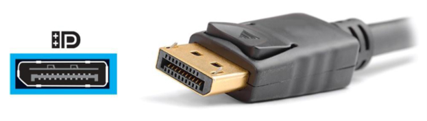

> Figura 2.7 DisplayPort

#### HDMI

Otra mejora sobre DVI es **High-Definition Multimedia Interface (HDMI)**, una interfaz digital que puede transportar audio y video por el mismo cable. Los puertos HDMI se encuentran en decodificadores de televisión por cable, televisores, adaptadores de video, portátiles, de escritorio y tabletas. Los conectores más pequeños miniHDMI o microHDMI se usan con dispositivos como cámaras, tabletas y teléfonos inteligentes. La Figura 2.8 muestra un puerto y un cable HDMI. La Tabla 2.1 describe los distintos puertos HDMI.

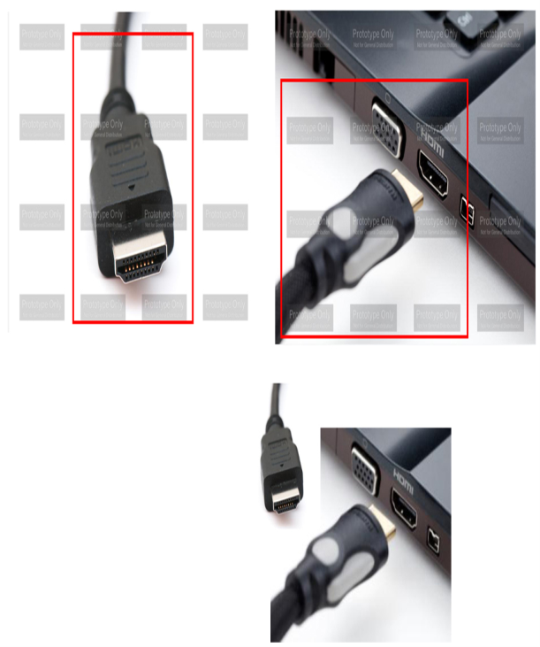

> Figura 2.8 Puerto y cable HDMI

> Tabla 2.1 Puertos HDMI

| Tipo de conector HDMI | Descripción |
|---|---|
| A | Puerto de 19 pines que se encuentra en un TV o PC y al que se puede conectar un cable de Categoría 1 (estándar) o Categoría 2 (alta velocidad). |
| B | Puerto de 29 pines usado con pantallas de muy alta resolución. |
| C | Puerto mini-HDMI de 19 pines que se encuentra en dispositivos móviles. |
| D | Puerto micro-HDMI de 19 pines que se encuentra en dispositivos móviles. |

La Figura 2.9 muestra una tarjeta de video que se usaría en una computadora para *gaming*. Arriba hay un puerto DVI-D *dual link*. Abajo, de izquierda a derecha, hay un DisplayPort, un puerto HDMI y un puerto DVI-I *dual link*. La Tabla 2.2 resume los puertos de video importantes de la PC. Ten en cuenta que los cables Thunderbolt, Lightning y USB también pueden transportar señales de video; estos puertos y cables se cubren en la sección «Puertos multipropósito», más adelante en este capítulo.

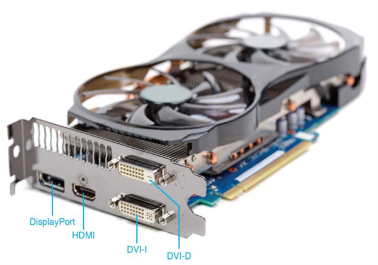

> Figura 2.9 Puertos de video, incluidos un DisplayPort, un puerto HDMI y dos puertos DVI

> Tabla 2.2 Resumen de los puertos de video

| Tipo de puerto | ¿Analógico, digital o ambos? | Velocidad máxima de transferencia | ¿Transporta audio? | Longitudes máximas de cable |
|---|---|---|---|---|
| VGA | Analógico | N/A | No | Depende de la resolución |
| DVI-D | Digital | Dual link 7.92 Gb/s | No | Hasta 15 pies (4.57 m) para resoluciones de pantalla de hasta 1920×1200 |
| DVI-I | Ambos | Single o dual link | No | No está en los estándares, pero como regla general hasta 15 pies (4.57 m) para resoluciones de pantalla de hasta 1920×1200 |
| DisplayPort | Digital | 80 Gb/s | Sí | 9.8 pies (3 m) para pasivo y 108 pies (32.9 m) para activo |
| HDMI | Digital | 48 Gb/s | Sí | No está en los estándares, pero como regla general hasta 16 pies (4.88 m) para cable estándar y hasta 49 pies (14.9 m) para cable de alta velocidad, de buena calidad y conectores |

#### Adaptadores y convertidores de video

Se pueden comprar convertidores para puertos de video para convertir de uno de los tipos principales a otro tipo. Por ejemplo, la Figura 2.10 muestra un adaptador DVI a HDMI (con ambos extremos visibles).

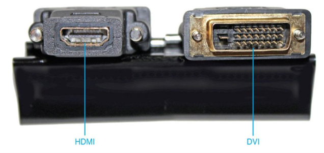

> Figura 2.10 Adaptador DVI a HDMI

### Puertos multipropósito

Algunos puertos/cables se pueden usar para múltiples dispositivos, incluidos USB 2.0, USB 3.x, USB 4, USB-C, Thunderbolt y Lightning. El puerto USB es probablemente el que más conoce la gente, pero los puertos Thunderbolt y Lightning también se consideran puertos multipropósito. Exploremos estos puertos.

#### Puertos USB

**USB** significa *Universal Serial Bus* y es uno de los puertos más populares. Un puerto USB permite que hasta 127 dispositivos conectados transmitan a velocidades de hasta 10 Gb/s (10 000 millones de bits por segundo), 20 Gb/s o incluso 40 Gb/s. Los dispositivos que se conectan a un puerto USB incluyen impresoras, escáneres, ratones, teclados, *joysticks*, unidades ópticas, *gamepads*, cámaras, módems, parlantes, teléfonos, videoteléfonos, guantes de datos y digitalizadores. A veces se pueden encontrar puertos adicionales en la parte delantera del gabinete de una PC o en el costado de un dispositivo móvil. La Figura 2.11 muestra algunos puertos USB.

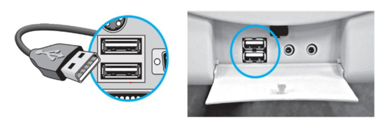

> Figura 2.11 Puertos USB

##### Versiones de USB

Los puertos USB vienen en varias versiones: USB 1.0/1.1, USB 2.0 (Hi-Speed), USB 3.0 (3.2 Gen 1 SuperSpeed y 3.2 Gen 2 SuperSpeed+) y 4.x. La Figura 2.12 muestra las distintas versiones de USB y los símbolos de velocidad.

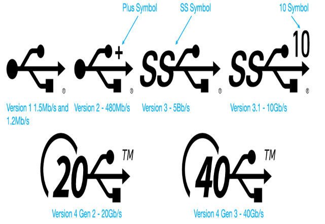

> Figura 2.12 Versiones, velocidades y símbolos de USB

##### Consejo técnico: la documentación puede ser clave para la velocidad USB

Un puerto no tiene que estar etiquetado, y a veces mirar las especificaciones técnicas de una computadora o placa madre es la única forma de determinar la velocidad del puerto.

##### Entrega de energía por USB (USB Power Delivery, USB-PD)

Los puertos USB han podido proporcionar 5 V a 500 mA, es decir, 2.5 vatios de potencia a los dispositivos, desde la versión 2.0. El estándar USB más nuevo, **Power Delivery** (PD o **USB-PD**), puede proporcionar hasta 20 V a 5 A, es decir, 100 vatios de potencia. El estándar en realidad tiene cinco niveles de entrega de energía: 10 W, 18 W, 36 W, 60 W y 100 W. Todas las conexiones USB4 permiten cargar un dispositivo USB.

##### Cables USB

Cada estándar USB tiene una longitud máxima de cable (que se muestra en la Tabla 2.3, más adelante en el capítulo). Los cables USB pueden ser más largos que estas especificaciones, pero los cables más largos pueden no funcionar bien. Puedes usar un cable de extensión USB activo (cable repetidor) o un hub USB con alimentación, que se cubre más adelante en el capítulo, para alcanzar distancias mayores.

Si un puerto USB proporciona energía a un dispositivo, la longitud máxima del cable se acorta. Por ejemplo, si se usa un dispositivo USB 2.0 PD, la longitud máxima del cable es menor a 13 pies (4 m). Si se usa un dispositivo USB 3.1 PD con un cable USB Type-C, la longitud del cable debe ser menor a 3.3 pies (1 m). Un dispositivo PD requiere un cable Type-C, pero no todos los puertos o cables admiten PD.

##### Conectores USB

Los puertos USB más antiguos se conocen comúnmente como **USB Type-A** y **USB Type-B**. Un cable de impresora USB, por ejemplo, tiene un conector macho Type-A en un extremo y un conector macho Type-B en el otro. El puerto en la computadora es un puerto Type-A. La Figura 2.13 muestra conectores Type-A y Type-B.

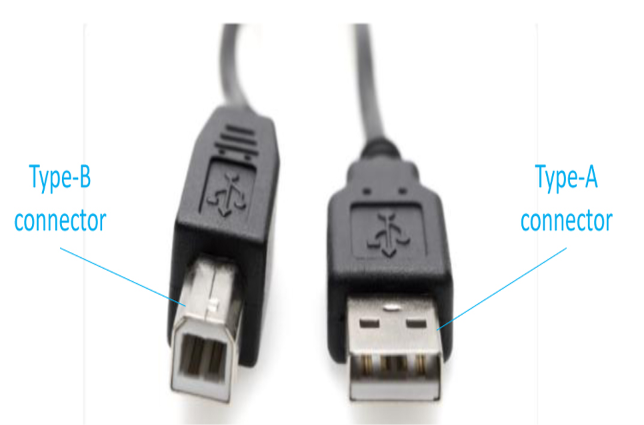

> Figura 2.13 Conectores USB Type-B y Type-A

El conector **USB Type-C** (a veces llamado USB-C) es el tipo más reciente y con el tiempo reemplazará a los conectores Type-A y Type-B. Con dispositivos más antiguos, es posible usar un adaptador para conectarse a un conector Type-C. Muchos puertos USB 3.0 son conectores Type-C, pero no tienen que serlo, ya que los puertos USB 3.1 y superiores requieren un cable Type-C. La Figura 2.14 muestra un conector y un cable USB Type-C junto a un puerto Type-A. Observa en la foto de un conector USB Type-C en la Figura 2.14 que el conector del cable podría insertarse en el puerto USB-C con cualquiera de sus lados hacia arriba.

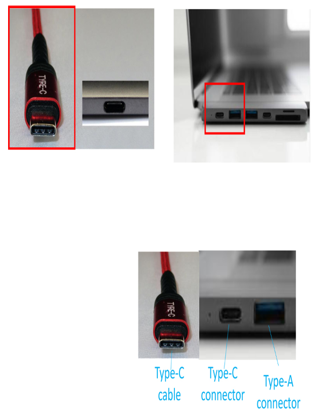

> Figura 2.14 Cable y conector USB Type-C y puerto Type-A

##### MiniUSB y MicroUSB

Dos puertos USB más pequeños que se usan en dispositivos portátiles como *hubs*, discos duros externos, cámaras digitales y teléfonos inteligentes son los puertos **miniUSB** y **microUSB**. Hay varios tipos de estos puertos USB más pequeños: mini-A, mini-AB, micro-B y micro-AB. Los puertos mini-AB y micro-AB aceptan un extremo de cable mini-A/micro-A o mini-B/micro-B. La Figura 2.15 muestra el cable USB Type-A estándar que se insertaría en un puerto de la PC, en comparación con los cables miniUSB y microUSB que se usan con dispositivos móviles. La Figura 2.16 muestra un puerto y conector USB 3.0 micro-B.

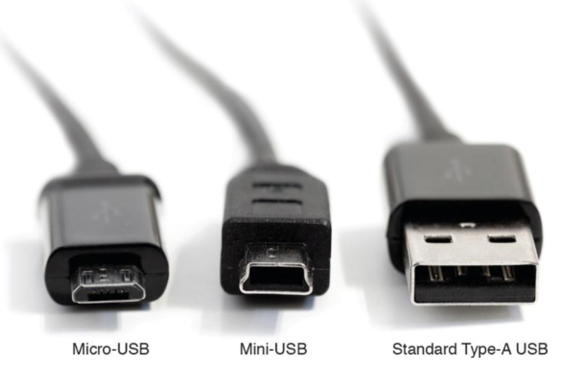

> Figura 2.15 Cables MicroUSB, miniUSB y USB Type-A

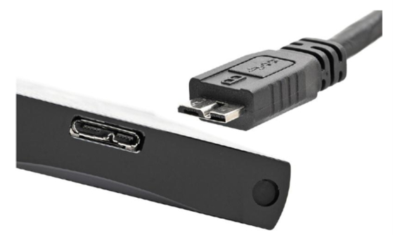

> Figura 2.16 Puerto y conector USB 3.0 micro-B

##### Hubs USB

Un puerto USB puede tener más de un dispositivo conectado a él mediante el uso de un **hub USB**. Muchos hubs pueden operar en dos modos de energía: **con alimentación propia** (*self-powered*) y **alimentado por el bus** (*bus powered*). Un hub con alimentación (a veces llamado *self-powered hub*) tiene una fuente de poder externa conectada. Un hub alimentado por el bus no tiene fuente de poder externa. Una vez que se prueban los dispositivos USB conectados a un hub, se puede retirar la fuente de poder del hub y volver a probar los dispositivos. Si todos los dispositivos conectados funcionan correctamente, la fuente de poder se puede dejar desconectada. La Figura 2.17 muestra la conectividad de un hub USB y la Figura 2.18 muestra las reglas de cableado USB.

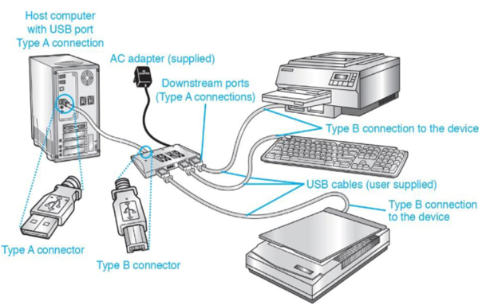

> Figura 2.17 Conectividad de un hub USB

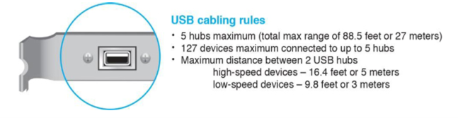

> Figura 2.18 Reglas de cableado USB

Los puertos USB siempre han podido proporcionar energía a dispositivos sin alimentación, como unidades flash. Un **puerto USB de carga** (*charging USB port*) es un puerto diseñado para poder proporcionar energía y cargar dispositivos conectados. Ten en cuenta que no todos los dispositivos USB se pueden encender mientras se cargan. Con un **puerto USB de dormir y cargar** (*sleep-and-charge*), el puerto proporciona energía para cargar el dispositivo incluso cuando la computadora está apagada. Consulta las especificaciones del dispositivo informático para ver si un puerto USB admite esta función. La Tabla 2.3 resume los tipos de USB, nombres alternativos, velocidades, colores de puerto y requisitos de cable.

> Tabla 2.3 Resumen de los puertos USB

| Tipo de puerto y nombre alternativo | Velocidad máxima de transmisión | Color del puerto | Tipo/longitud de cable y nombre alternativo |
|---|---|---|---|
| USB 1.x (1.0 velocidad baja / 1.1 velocidad completa) | 1.5 Mb/s y 12 Mb/s | Normalmente blanco | 9.8 pies (3 m) — Type-A |
| USB 2.0 Hi-Speed | 480 Mb/s | Negro | 9.8 pies (3 m) — Type-A |
| USB 3.0 SuperSpeed | 5 Gb/s | Azul | 9.8 pies (3 m) — Type-A o Type-C |
| USB 3.1 Gen 1 SuperSpeed | 5 Gb/s | Azul | 9.8 pies (3 m) — Type-A o Type-C |
| USB 3.1 Gen 2 SuperSpeed+ | 10 Gb/s | Verde azulado (teal) | 9.8 pies (3 m) — Type-C |

##### Consejo técnico: extraer dispositivos USB de forma segura

Para extraer un dispositivo USB, no basta con desenchufarlo del puerto. En su lugar, haz clic en el icono **Quitar hardware de forma segura** (Windows 7) o **Quitar hardware de forma segura y expulsar medios** (Windows 8/10/11) en el área de notificación y luego selecciona el dispositivo USB que quieres extraer. En una Mac, haz clic con el botón derecho en el icono de escritorio del dispositivo y selecciona *Eject x* (donde *x* es el nombre del dispositivo), o arrastra el icono del escritorio a la papelera. En Ubuntu Linux, localiza el dispositivo en Archivos o en el Explorador de archivos. Haz clic en el pequeño icono de expulsión. El sistema operativo avisa cuando es seguro desenchufar el dispositivo.

##### Convertidores USB

Hay convertidores disponibles para convertir un puerto USB a un tipo de conector diferente (o viceversa), como el convertidor USB a Ethernet que se usa para conectar un dispositivo, como una tableta que tiene un puerto USB, a una red Ethernet cableada (ver la Figura 2.19).

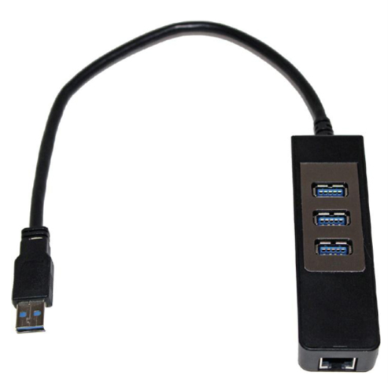

> Figura 2.19 Convertidor USB a Ethernet

##### Instalar puertos USB adicionales

A veces la gente quiere más puertos USB y no quiere agregar otro hub. Muchas placas madre admiten agregar dos o más puertos USB usando un cable que se conecta a un conector USB interno de la placa madre, también conocido como **header USB**. El término *header* simplemente significa un conjunto de pines de la placa madre para un propósito específico, como USB 2.0, USB 3.0, USB Type-C, SATA, eSATA, LED RGB (luces) y TPM (Trusted Platform Module). Los puertos se montan en el espacio de una ranura de expansión, pero no tienen una tarjeta que se inserte en una ranura de expansión. Incluso si una placa madre tiene esos pines, es posible que los puertos y el conjunto de cables deban comprarse por separado. La Figura 2.20 muestra puertos USB de ejemplo que se conectan a una placa madre.

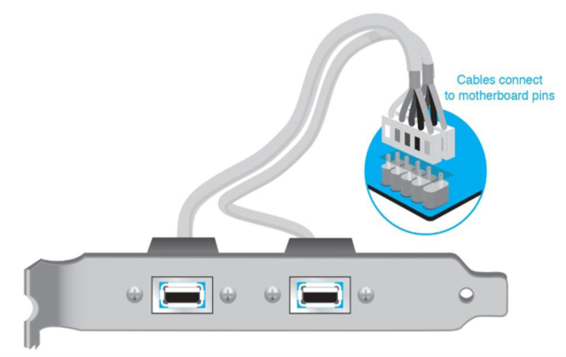

> Figura 2.20 Instalar puertos USB adicionales

#### Thunderbolt

Un **puerto Thunderbolt** es un tipo de puerto que se usa principalmente para video, utiliza parte de la tecnología del puerto de video DisplayPort y puede transportar energía, audio, video y datos a dispositivos de almacenamiento externos. La interfaz Thunderbolt fue desarrollada por Intel con el apoyo de Apple. El puerto Thunderbolt usado en las computadoras Apple es el mismo conector que el miniDisplayPort; sin embargo, Thunderbolt 3 usa el conector USB Type-C, que se analizó antes en este capítulo, en la sección «Conectores USB». Thunderbolt 3 es la primera versión de Thunderbolt que admite USB.

Un cable Thunderbolt puede tener velocidades de datos de hasta 80 Gb/s. Thunderbolt permite encadenar en margarita (*daisy-chaining*) hasta seis dispositivos. La Figura 2.21 muestra un puerto y un cable Thunderbolt. Vuelve a la Figura 2.14 para ver el conector y el cable Type-C que usan Thunderbolt 3 y 4.

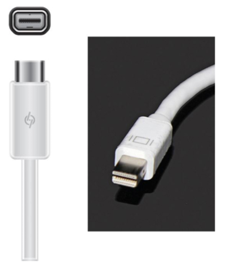

> Figura 2.21 Cable y puerto Thunderbolt

##### Consejo técnico: ¿puede funcionar un dispositivo Thunderbolt 3 o 4 en un puerto USB-C?

Incluso si un dispositivo Thunderbolt 3 o 4 puede conectarse a un puerto USB-C, es posible que no funcione. Si el dispositivo funciona, lo hará a velocidad USB-C. Sin embargo, los dispositivos USB-C sí pueden funcionar y conectarse a un puerto Thunderbolt 3 o 4.

#### Lightning

El último puerto multipropósito que cubriremos es el **puerto Lightning** y su cable asociado. El puerto Lightning, desarrollado por Apple, es un puerto de 8 pines que acepta el cable con cualquiera de sus lados hacia arriba (es decir, es reversible). El puerto Lightning puede transportar datos y energía desde dispositivos móviles a otros dispositivos, como cámaras, monitores externos y dispositivos de almacenamiento externos. Se puede usar un adaptador/convertidor para permitir que el cable se use con el conector Apple de 30 pines más antiguo, USB, HDMI, VGA o tarjetas SD. El puerto Lightning admite datos y carga por USB, pero el puerto o cable Lightning no es intercambiable con USB-C. Ten en cuenta que algunas computadoras MacBook tienen conectores USB-C, no Lightning. La Figura 2.22 muestra un cable Lightning. La Tabla 2.4 muestra una comparación de los tres puertos multipropósito.

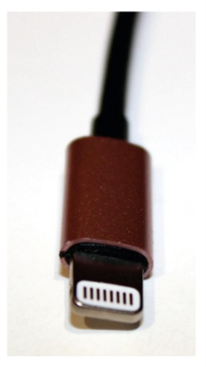

> Figura 2.22 Cable Lightning

> Tabla 2.4 Comparación de puertos multipropósito

| Tipo de puerto | Velocidad máxima de transmisión | Tipo de conector | Plataformas | Qué transporta |
|---|---|---|---|---|
| USB 4 Gen 3 | 40 Gb/s | Conector reversible USB Type-C de 24 pines | Se encuentra en Apple y PC | Datos y energía |
| Thunderbolt 4 | 80 Gb/s | Conector reversible USB Type-C de 24 pines | Desarrollado por Intel y Apple | Datos y energía |
| Lightning | Velocidades de hasta USB 3.0, pero normalmente 480 Mb/s | Conector reversible de 8 pines propiedad de Apple | Apple | Datos y energía |

### Puertos de audio

Una **tarjeta de sonido** (*sound card*, a veces llamada *audio card*) convierte las señales digitales de la computadora en sonido y el sonido en señales digitales de la computadora (ver la Figura 2.3). Los puertos de sonido comúnmente están integrados en la placa madre, pero algunas personas quieren mejor sonido y por eso agregan una tarjeta. Los puertos de sonido más comunes incluyen un puerto para micrófono y uno o más puertos para parlantes. Los puertos pueden aceptar señales analógicas o digitales.

Los puertos de sonido analógicos tradicionales son de 3.5 mm (ver la Figura 2.23). Los puertos de entrada/salida **Sony/Phillips Digital Interface (S/PDIF)** más nuevos, a la izquierda en la Figura 2.23, se usan para conectar diversos dispositivos, como reproductores/grabadores de cinta de audio digital, reproductores/grabadores de DVD y reproductores/grabadores de discos externos. Hay dos tipos principales de conectores S/PDIF: un *jack* RCA (el último puerto a la izquierda) que se usa para conectar un cable coaxial y un puerto de fibra óptica para una conexión de cable TOSLINK (dos puertos ópticos junto al *jack* RCA/Digital Out en la Figura 2.23). Las tarjetas de sonido son populares porque la gente quiere mejor calidad de sonido que la disponible con los puertos integrados en una placa madre.

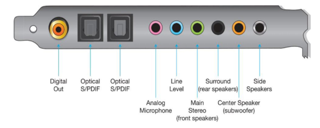

> Figura 2.23 Puertos de una tarjeta de sonido

### Puertos eSATA

Las conexiones SATA se usan comúnmente para dispositivos de almacenamiento internos y externos. Un puerto **external serial AT attachment (eSATA)** de 7 pines sin alimentación se usa para conectar almacenamiento externo. Las computadoras de escritorio comúnmente tienen un *header* SATA para que se pueda agregar fácilmente un puerto eSATA. eSATA puede transferir datos a 6 Gb/s. Los dispositivos pueden conectarse a un máximo de aproximadamente 6.6 pies (2 m). Si el disco SATA interno se ha averiado, se puede usar un disco externo conectado a un puerto eSATA o USB para arrancar y diagnosticar el sistema.

Una variación del puerto eSATA es el **puerto eSATAp**, también conocido como eSATA/USB o *power over eSATA*. Esta variación puede aceptar cables eSATA o USB y proporciona energía cuando es necesario. La Figura 2.24 muestra un cable eSATA estándar, un puerto eSATA y un puerto eSATAp (combinación eSATA/USB).

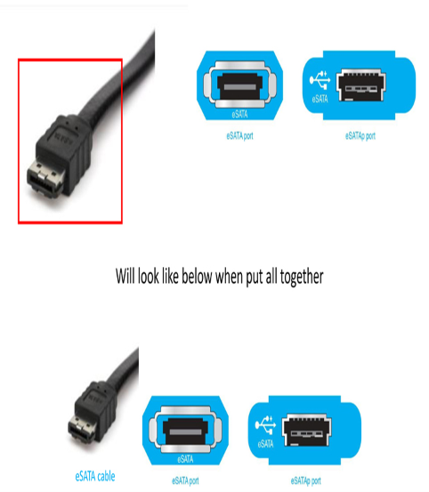

> Figura 2.24 Cable eSATA y puertos eSATA/eSATAp

### Puertos de módem y serie

Un **modulador/demodulador**, o **módem**, conecta una computadora digital a un tipo diferente de red, como una línea telefónica o una conexión a internet. Un módem interno usado para conectar una computadora a una red telefónica es un adaptador que tiene uno o dos puertos de *jack* telefónico RJ11. El puerto RJ11 etiquetado *Line* es para la conexión al *jack* de pared; el etiquetado *Phone* es para una conexión de teléfono, si es necesario. La Figura 2.25 muestra un módem interno con dos puertos RJ11.

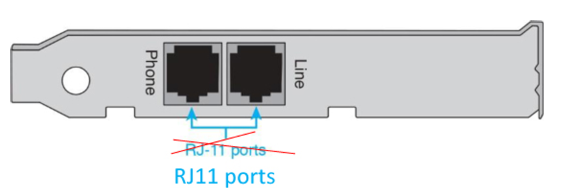

> Figura 2.25 Un módem interno con dos puertos RJ11

El mismo tipo de puerto RJ11 con cuatro conductores se usa con un módem de cable que conecta una red doméstica a internet, y el puerto RJ11 se usa para conectar un teléfono. La Figura 2.26 muestra este puerto etiquetado como *Phone Lines 1&2*.

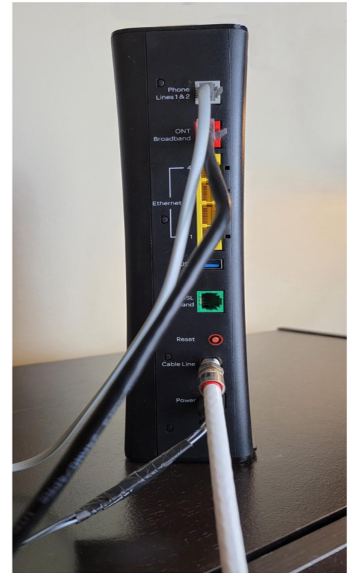

> Figura 2.26 Módem de cable con puerto RJ11

Los **puertos serie** (*serial ports*) se encuentran en módems y placas madre más antiguos, equipos de red, sistemas de alarma, sistemas de automatización, sistemas de comunicación y sistemas de placa única como la Raspberry Pi y la ASUS Tinker Board. Los puertos serie son macho de 9 pines (es decir, tienen pines en lugar de agujeros) y a veces se llaman puertos **DB9** o **RS-232**. La Figura 2.27 muestra los puertos serie DB9 en una computadora más antigua. La Figura 2.28 muestra un ejemplo de un cable serie. El conector hembra DB9 se conectaría al conector macho DB9 en un dispositivo o placa madre. La Figura 2.29 muestra un cable convertidor USB a serie que podrías necesitar para conectar un módem externo a una placa madre moderna.

> Figura 2.27 Puertos serie DB9

> Figura 2.28 Extremos de un cable serie

> Figura 2.29 Convertidor de puerto USB a serie

### Puertos de red

Un **puerto de red** (*network port*) se usa para conectar un dispositivo como una computadora o una impresora a una red. El tipo más común de puerto de red es un **puerto Ethernet**, también conocido como **puerto RJ45**. Un cable de red se inserta en un puerto Ethernet para conectar un dispositivo informático a una red cableada. A un puerto de red a veces se le llama **NIC** (*network interface card* o *controller*). Observa los 8 conductores (alambres) en el puerto Ethernet RJ45 que se muestra en la Figura 2.30.

> Figura 2.30 Un puerto Ethernet RJ45

Un puerto RJ45 se parece mucho a un *jack* telefónico RJ11 (ver las Figuras 2.25 y 2.26). Sin embargo, el conector RJ45 tiene 8 conductores (alambres) en lugar de 4. Observa con atención los conectores en la Figura 2.31 para ver la diferencia. El conector RJ11 está a la izquierda.

> Figura 2.31 Conectores RJ11 y RJ45

##### Consejo técnico: símbolos del puerto Ethernet

Un puerto Ethernet comúnmente tiene LED en la parte superior o cerca del puerto para indicar actividad de datos. Este puerto también puede tener uno de los siguientes símbolos.

### Cableado de red

Las personas que trabajan en IT tienen todo tipo de dispositivos —incluidas PC, impresoras, servidores, proyectores y pantallas— que se conectan a la red. Este es un buen momento para asegurarte de saber qué tipo de cable podría usarse. Empezaremos con el cable de cobre, que envía pulsos eléctricos para crear los 1s y 0s digitales, y luego veremos el cableado de fibra óptica, que usa luz en su lugar.

#### Coaxial

Un tipo de conector que quizá veas asociado con video, pero más probablemente con televisión por cable o al conectar una antena de red inalámbrica a un conector, es un conector **Bayonet Neill–Concelman (BNC)**. Un conector BNC se usa con un cable **coaxial** que se encuentra en redes de video, como una escuela donde varios televisores se conectan al mismo centro de distribución, o en un hogar que obtiene canales de TV a través de un proveedor de cable. Un conector BNC tiene un conductor central que se presiona sobre el receptáculo y está rodeado de aislamiento. Fuera del aislamiento hay una malla de cobre trenzado, una lámina metálica o ambas, para proteger el conductor central de los ruidos externos llamados **interferencia electromagnética (EMI)**, como se muestra en la Figura 2.32. La Figura 2.33 muestra el frente de un conector BNC ya colocado en el cable coaxial.

> Figura 2.32 Cable coaxial con un conector BNC

> Figura 2.33 Conector BNC

La Figura 2.34 muestra dos conectores coaxiales populares: BNC y F. Observa que el conector BNC tiene un lado con muescas para girar y enroscarse en el conector receptor. El conector tipo F simplemente se atornilla en el conector receptor. La Tabla 2.5 enumera los tipos de cables coaxiales.

> Figura 2.34 Conectores coaxiales BNC y F

> Tabla 2.5 Tipos de cable coaxial

| Tipo de cable coaxial | Descripción |
|---|---|
| RG-6* | Este es el tipo de cable con menos probabilidades de usarse en una red. Es un cable de 75 ohmios adecuado para distribuir señales de TV por cable, antenas parabólicas o antenas de azotea. Tiene mejor blindaje que el RG-59, por lo que es de mayor diámetro. Las distancias típicas son de 1000 pies (305 m) a 1500 pies (457 m). Puede transportar frecuencias de hasta 2200 MHz. |
| RG-59 | Este tipo de cable de 75 ohmios no se usa en LAN, pero sí en instalaciones de video. Las distancias típicas son de 750 pies (225 m) a 1000 pies (305 m). Puede transportar frecuencias de hasta 1000 MHz. |

*RG significa *radio grade* (grado de radio).

Si un cable coaxial de impedancia diferente se conecta a otro cable coaxial, se produce pérdida de señal. El cable coaxial se clasifica según si se usará en un espacio interior o exterior. Usa el tipo de cable adecuado para la instalación. Ten cuidado al doblar el cable. Cuando hay un problema y se usan el tipo de cable y conector correctos, el problema más común es que el conector coaxial no está bien conectado.

#### Cable Ethernet

**Ethernet** es el tipo de red cableada más común que se ve en hogares y empresas. Un cable Ethernet se conecta a un puerto Ethernet RJ45. El tipo más común de cable de red es el **par trenzado sin blindaje (UTP)**. UTP viene en varios tipos: Cat 5, Cat 5e, Cat 6 y Cat 6a. Cat 7 y Cat 8 también están disponibles. El *Cat* en estos nombres de cable es abreviatura de *category* (categoría).

El cable UTP tiene 8 alambres que están trenzados para evitar que los datos que viajan por un alambre interfieran con un alambre adyacente; este tipo de interferencia se llama **diafonía** (*crosstalk*). La Figura 2.35 muestra un cable Cat 6 y un cable Cat 5e. Observa que el cable Cat 6 es más delgado. La Tabla 2.6 muestra una comparación de los tipos de cable. Cat 6a tiene más trenzados de cable para reducir la diafonía (datos de un alambre que interfieren con los datos de un alambre adyacente). El cableado Cat 6a también puede tener un conductor y una funda más gruesos.

> Figura 2.35 Cable Cat 6 y Cat 5e

> Tabla 2.6 Comparación de cables Ethernet

| Tipo de cable Ethernet | Velocidad máxima de transmisión | Ancho de banda | Limitación de distancia |
|---|---|---|---|
| Cat 5 | 100 Mb/s | 100 MHz | 328 pies (100 m) |
| Cat 5e | 1000 Mb/s, o 1 Gb/s | 100 MHz | 328 pies (100 m) |
| Cat 6 | 1000 Mb/s, o 1 Gb/s* | 250 MHz | 328 pies (100 m) |
| Cat 6a | 10 000 Mb/s, o 10 Gb/s | 500 MHz | 328 pies (100 m) |
| Cat 7 | 10 000 Mb/s, o 10 Gb/s | 600 MHz | 328 pies (100 m) |
| Cat 8 | 25 000/40 000 Mb/s, o 25/40 Gb/s | 2000 MHz | 328 pies (100 m) |

*Cat 6 puede admitir velocidades de 10 Gb/s en longitudes de hasta 165 pies (55 m).

La alternativa al UTP es el **cable de par trenzado blindado (STP)**, que se usa en manufactura, con sistemas de alarma de seguridad, para conexiones de audio, entre edificios y en entornos hostiles donde el cableado necesita un poco más de blindaje para mantener los datos intactos. El blindaje lo proporciona una lámina envuelta alrededor de todos los cables, así como alrededor de cada grupo de dos cables, lo que hace que el cableado STP sea más grueso que el UTP. El cableado Cat 7 y Cat 8 usan este tipo. El STP también se usa con cable de enterramiento directo y subterráneo en un entorno exterior. El **cable de enterramiento directo** (*direct burial cable*) está diseñado para usarse bajo tierra sin ninguna protección adicional (como tubería, cañería o cobertura extra), porque este tipo de cableado tiene aislamiento, cobertura e impermeabilización adicionales. También hay cable UTP de enterramiento directo, diseñado para proteger contra la humedad.

Tanto el UTP como el STP usan el conector RJ45, que tiene una lengüeta (*tang*) en un lado. Para quitar un cable de un puerto Ethernet, presiona la lengüeta para liberar el cable del puerto. Al insertar el cable, asegúrate de que esté orientado correctamente y luego empuja el cable firmemente en el puerto hasta que escuches un clic de la lengüeta encajando bien en el puerto. La Figura 2.36 muestra la parte superior e inferior de un conector de cable Ethernet.

> Figura 2.36 Conector Ethernet RJ45 con lengüeta

El cableado Ethernet en un entorno corporativo hace uso de un **panel de conexiones** (*patch panel*) para llevar el cableado de una parte de un edificio a la siguiente. En la parte posterior de un panel de conexiones hay un **bloque punchdown** (*punchdown block*), que también se encuentra en las redes telefónicas tradicionales. La Figura 2.37 muestra a un técnico usando una **herramienta punchdown** para fijar firmemente un alambre en un bloque punchdown.

> Figura 2.37 Conectar un alambre en un bloque punchdown usando una herramienta punchdown

Un tipo especial de cable UTP o STP es el **cable plenum** (*plenum cable*). Un *plenum* es el espacio de circulación de aire de un edificio para los sistemas de calefacción y aire acondicionado. El cable plenum se trata con Teflón u otros materiales ignífugos para reducir el riesgo de incendio. El cable plenum produce menos humo y es menos tóxico al quemarse que el cable de red normal.

Una alternativa al cable plenum es el cable de **policloruro de vinilo (PVC)**, que tiene un aislamiento o funda de plástico. El PVC es más barato que el cable plenum y se le pueden agregar químicos ignífugos para que cumpla con los códigos de construcción. El PVC suele ser más fácil de instalar que el cable plenum.

Para evitar tiempo extra de diagnóstico, la mayoría de las empresas instala su cable de red según el estándar **ANSI/TIA/EIA-568-A o 568-B** (comúnmente mostrado como T568A y T568B o 568A/B). Estos estándares especifican hasta dónde puede extenderse el cable, cómo etiquetarlo, qué tipo de conectores usar, y así sucesivamente. La Figura 2.38 muestra que los alambres de colores dentro de un conector deben estar en un orden particular. El Capítulo 13, «Redes», muestra cómo fabricar cables según los estándares T568A y T568B.

> Figura 2.38 Estándares de cableado ANSI/TIA/EIA T568A y T568B

#### Medios de fibra

El **cable de fibra** (*fiber cable*), también conocido como **cable óptico** o cable de fibra óptica, está hecho de vidrio o de un tipo de fibra plástica y se usa para transportar pulsos de luz. El cable de fibra se puede usar para conectar una estación de trabajo a otro dispositivo, pero en la industria los usos más comunes del cable de fibra óptica son conectar redes que forman la **columna vertebral** (*backbone*) de la red, redes entre edificios, redes de alta velocidad de proveedores de servicios y hogares a un proveedor de servicios. La Figura 2.39 muestra conexiones de un *switch* de fibra. Observa que las fibras están agrupadas en pares.

> Figura 2.39 Conexiones de fibra

Hay muchos tipos diferentes de conectores de fibra, y algunos son propietarios. Cuatro de los conectores más comunes usados con cable de fibra óptica son **Mechanical Transfer Registered Jack (MT-RJ)** (común en instalaciones domésticas), conector **straight tip (ST)**, **subscriber connector (SC)** y **Lucent connector (LC)**. La Figura 2.40 muestra tres de estos conectores.

> Figura 2.40 Tipos de conectores de fibra óptica

Las dos clasificaciones principales de fibra son **monomodo** (*single-mode*) y **multimodo** (*multi-mode*). El cable de fibra monomodo envía solo un haz de luz por el cable. La fibra multimodo permite enviar múltiples señales de luz por el mismo cable. La Tabla 2.7 describe las características de los dos tipos. (Ten en cuenta que las velocidades máximas de la fibra siguen aumentando a medida que la tecnología sigue cambiando.)

> Tabla 2.7 Velocidad y características de transmisión del cable de fibra

| Tipo | Característica |
|---|---|
| Monomodo (*single-mode*) | Se clasifica por el tamaño del núcleo de la fibra y el revestimiento. Los tamaños comunes incluyen de 8/125 a 10/125 micrómetros, donde el primer número representa el tamaño del núcleo y el segundo el tamaño del revestimiento. El cable monomodo permite distancias de más de 50 millas (80 km) a velocidades de más de 100 Gb/s. |
| Multimodo (*multi-mode*) | Los tamaños incluyen 50/125 y 62.5/125 micrómetros. Puede admitir distancias de más de 1 milla (2 km) y velocidades de hasta 10 Gb/s. Los conectores ST se usan más con fibra multimodo que con monomodo. |

##### Consejo técnico: elegir el tipo de fibra correcto

La fibra multimodo es más barata y más usada que la fibra monomodo y es buena para aplicaciones de menor distancia; sin embargo, la fibra monomodo puede transmitir una señal más lejos que la multimodo y admite el mayor ancho de banda.

### Puertos integrados en la placa madre

Una placa madre integrada proporciona capacidad de expansión porque los puertos están incorporados y no requieren adaptadores separados. Si una placa madre incluye puertos USB, de red, de sonido, de teclado, de ratón y de video, hay más espacio disponible para otros adaptadores. El número de ranuras de expansión disponibles en un sistema depende del fabricante de la placa madre. La Figura 2.41 muestra puertos integrados en la placa madre, incluidos puertos para conectar dos antenas inalámbricas Wi-Fi 6.

> Figura 2.41 Puertos integrados en la placa madre

Los puertos incorporados en una placa madre son más rápidos que los de una placa de expansión. Todos los adaptadores en las ranuras de expansión funcionan más lentamente que los componentes de la placa madre. Las computadoras con placas madre integradas son más fáciles de configurar porque no tienes que instalar un adaptador ni configurar los puertos. Normalmente, los sistemas con placas madre integradas son más fáciles de diagnosticar porque los componentes están en una sola placa. La desventaja es que, cuando un puerto se avería, tienes que agregar un adaptador que tenga el mismo tipo de puerto que el que se averió. Además, los puertos que se encuentran en un adaptador pueden ser de mayor calidad o tener más capacidades que un puerto integrado. Ver la Figura 2.42.

> Figura 2.42 Ventajas de los adaptadores

### Conocer los puertos

Poder identificar los puertos de forma rápida y precisa es una habilidad crítica en la reparación de computadoras. La Tabla 2.8 enumera los puertos de computadora más comunes.

> Tabla 2.8 Puertos comunes

| Puerto | Uso | Color del puerto | Conector común |
|---|---|---|---|
| PS/2 mouse (ratón) | Ratón | Verde | mini-DIN de 6 pines |
| PS/2 keyboard (teclado) | Teclado | Púrpura | mini-DIN de 6 pines |
| VGA | Video para un monitor analógico | Azul | D-shell hembra de 15 pines en 3 filas o puerto mini-VGA |
| DVI | Video para un monitor DVI digital o analógico | Blanco | DVI hembra de 18 o 24 pines en 3 filas, mini-DVI o micro-DVI |
| DVI-D | Video para un monitor DVI digital | Blanco | DVI hembra de 18 o 24 pines en 3 filas, mini-DVI o micro-DVI |
| DVI-A | Video para un monitor DVI analógico | Blanco | DVI hembra de 18 o 24 pines en 3 filas, mini-DVI o micro-DVI |
| HDMI | Monitor de audio y video digital | N/A | HDMI de 19 o 29 pines, mini-HDMI o micro-HDMI |
| DisplayPort | Monitor de audio y video digital | N/A | DisplayPort de 20 pines o mini-DisplayPort |
| USB | Puerto multipropósito para datos, video, audio y energía | Negro, azul, verde azulado o rojo | USB Type-A, Type-B, Type-C, mini-USB, micro-USB |
| Thunderbolt | Puerto multipropósito que puede transportar datos, video, audio y energía | N/A | DisplayPort de 20 pines, mini-DisplayPort o conector USB Type-C |
| Lightning | Puerto multipropósito para dispositivos Apple que puede transportar datos y energía | N/A | Conector de 8 pines |
| Audio | Entrada de audio analógica | Rosa claro | Jack de 1/8 de pulgada (3.5 mm) |
| Audio | Entrada de audio analógico a nivel de línea | Azul claro | Jack de 1/8 de pulgada (3.5 mm) |
| Audio | Salida de audio analógico a nivel de línea de la señal estéreo principal | Verde lima | Jack de 1/8 de pulgada (3.5 mm) |
| Audio | Audio analógico a nivel de línea para altavoz de derecha a izquierda | Marrón | Jack de 1/8 de pulgada (3.5 mm) |
| S/PDIF | Entrada/salida de audio | Naranja | Jack RCA (coax) o TOSLINK (fibra) |
| RJ45 | Red Ethernet UTP | N/A | 8 conductores |
| RJ11 | Módem interno/externo o teléfono | N/A | 4 conductores |

## Conectividad inalámbrica para dispositivos de entrada

Muchos dispositivos de entrada, como teclados, ratones, *gamepads*, *touchpads* y auriculares, tienen conectividad inalámbrica. Las tecnologías usadas para conectarse sin cable incluyen **infrarrojo (IR)**, **radio**, **Bluetooth** y **comunicación de campo cercano (NFC)**. Muchos dispositivos informáticos, especialmente teléfonos inteligentes y otros dispositivos móviles, tienen conectividad inalámbrica integrada; de lo contrario, se conecta un transceptor a un puerto USB para permitir la conectividad con el dispositivo informático. La Figura 2.43 muestra un presentador inalámbrico usado con un dispositivo informático y un proyector.

> Figura 2.43 Presentador inalámbrico

La Tabla 2.9 resume las distintas tecnologías inalámbricas usadas con dispositivos de entrada y salida.

> Tabla 2.9 Tecnologías inalámbricas de entrada/salida

| Tecnología | Descripción |
|---|---|
| Infrarrojo (IR) | Se usa para distancias muy cortas. Más barato que otras tecnologías. |
| Radio | Funciona en los rangos de frecuencia de radio de 27 o 900 MHz, o 2.4, 5 o 60 GHz. Admite distancias más largas que el infrarrojo. |
| Bluetooth | Incluye seguridad de 128 bits y funciona en el rango de 2.4 GHz. Hay cuatro clases de dispositivos, con alcances de hasta 1.6 pies (0.5 m), 3 pies (1 m), 33 pies (10 m) y 328 pies (100 m). Ten en cuenta que Bluetooth 5 admite una conexión entre dos dispositivos a hasta 800 pies (242 metros) de distancia. Se pueden conectar hasta ocho dispositivos, con solo un dispositivo controlando a los demás. |
| Comunicación de campo cercano (NFC) | Se usa para imprimir desde un teléfono o una cámara, o para transferir datos entre dos teléfonos inteligentes colocados muy cerca uno del otro (menos de 6 pulgadas [15.24 cm]). También se usa en sistemas de pago. Funciona en el rango de 13.56 MHz a velocidades de transferencia de hasta 424 kb/s. |

## Habilidades blandas: usar los títulos apropiados

Internet y los dispositivos móviles han traído nuevos métodos de comunicación. En el mundo de las redes sociales de hoy, la comunicación tiende a ser más informal, y la gente usa coloquialismos, jerga y otros hábitos de lenguaje que no son necesariamente profesionales. Además, algunas personas usan regularmente acrónimos, como HAGD, LOL, BTW, NRN, TYVM y YMMD, para comunicarse en correos electrónicos, notas, mensajes de texto y memorandos.

Muchos lugares de trabajo están volviendo a lo básico en lo que respecta al servicio al cliente, y estas empresas esperan que tú, como profesional de IT, uses métodos de comunicación profesionales. La gente espera que el departamento de IT use habilidades de comunicación más profesionales, y por lo tanto se enfatizan mejores habilidades blandas durante el proceso de contratación. Por ejemplo, se espera que el personal de IT use títulos apropiados, como Dr., Sr., Profesor y Sra., al hablar con personal ajeno a IT, incluidos proveedores externos. En el entorno laboral, debes usar el título de una persona, *señor* o *señora*, hasta que la persona a la que te diriges te indique lo contrario. La Figura 2.44 muestra un par de ejemplos.

> Figura 2.44 En el trabajo, usa saludos apropiados

## Resumen del capítulo

- Un técnico debe poder identificar una variedad de puertos, incluidos los puertos PS/2 de ratón y teclado, VGA, DVI, HDMI, DisplayPort, Thunderbolt, Lightning, USB, RJ45, RJ11, *jack* de sonido de 3.5 mm, TOSLINK, RCA, DB9, eSATA y eSATAp.
- USB es el tipo de conexión más popular para agregar dispositivos a computadoras de escritorio, portátiles y tabletas.
- USB proporciona energía: 10 W, 18 W, 36 W, 60 W y 100 W. Todos los puertos USB4 admiten la carga de un dispositivo USB.
- Agrega puertos USB adicionales conectando un hub que puede ser con alimentación propia o alimentado por el bus. Se pueden encadenar en margarita hasta cinco hubs a un puerto.
- Conecta un cable USB interno desde un conector de la placa madre a una placa metálica que se monta en una ranura de expansión vacía para obtener más puertos USB.
- Hay adaptadores disponibles para convertir entre distintos tipos de puertos de pantalla, como DVI y VGA, o DVI y HDMI.
- Hay convertidores disponibles para puertos USB, como USB a Ethernet, si el puerto Ethernet se avería en una computadora.
- Los puertos de audio pueden ser analógicos o digitales. Los puertos S/PDIF son digitales. Hay dos tipos de puertos S/PDIF: TOSLINK y de fibra.
- Los puertos Ethernet tienen conectores RJ45. Los puertos RJ11 se encuentran en módems y dispositivos usados para conectarse a internet.
- Los puertos DB9 se pueden encontrar en módems, computadoras de placa única y equipos de red.
- Los puertos Ethernet comúnmente tienen un cable Cat 5e, 6 o 6a conectado. Los cables Ethernet pueden ser de par trenzado sin blindaje o, si se necesita blindaje adicional, de par trenzado blindado. El cableado plenum está hecho de materiales ignífugos. Un tipo de cable más barato es el PVC. Los cables Ethernet cumplen con el estándar T568A o T568B.
- El cableado de fibra transporta datos a distancias más largas, y el cableado coaxial (*coax*) se usa para redes de video.
- Los dispositivos de entrada pueden conectarse a una computadora usando cuatro tecnologías inalámbricas: IR, radio, Bluetooth o NFC.
- Al hablar con otras personas, usa los títulos profesionales apropiados cuando corresponda.

### Consejos para el examen de certificación A+

- Sé capaz de identificar los siguientes conectores: RJ11, RJ45, tipo F, ST, LC, SC, USB, microUSB, miniUSB, USB-C, DB9 y Lightning. (En tarjetas de 3×5, escribe los nombres de los puertos que te cueste recordar. Pon una imagen del puerto en un lado y el nombre del puerto en el otro. Incluye también el tipo de conector al que se conecta cada tipo de cable, por ejemplo: RJ11 es un conector para un cable telefónico; RJ45 es un conector para un cable de red; BNC es un conector para cable coaxial; y DB9 se usa en un cable serie. Practica hasta conocerlos todos.)
- Explica dónde verías y cómo reconocerías un bloque punchdown.
- Sé capaz de describir los siguientes cables de red y de describir las características de cada uno: Ethernet (Cat 5, Cat 5e, Cat 6, Cat 6a, plenum, par trenzado blindado, par trenzado sin blindaje y el estándar T568A/B), fibra y coaxial. Conoce que el cable STP de enterramiento directo se usa entre edificios sin necesidad de tubería o conductos especiales. (Haz un cuadro con las características clave de cada uno de estos tipos de cable. Pídele a alguien que te tome una prueba sobre ellos.)
- Sé capaz de explicar los siguientes cables de video, sus características y sus propósitos: VGA, HDMI, DisplayPort y DVI. (Haz una búsqueda de imágenes en la web de puertos de video y comprueba si puedes reconocer estos puertos.)
- Sé capaz de explicar las características y propósitos de los siguientes cables: serie, Thunderbolt, USB 2.0 y USB 3.0. (Haz otro cuadro para cada uno de estos cables y las características de cada uno.)
- Las siguientes habilidades de comunicación y profesionalismo forman parte del examen 220-1102: ser culturalmente sensible y usar títulos profesionales apropiados cuando corresponda.

## Términos clave

- 568A/B
- Señal analógica — *analog signal*
- Bluetooth
- Conector BNC — *BNC connector*
- Cat 5
- Cat 5e
- Cat 6
- Cat 6a
- Puerto USB de carga — *charging USB port*
- Coaxial — *coaxial*
- Cableado de cobre — *copper cabling*
- DB9
- Señal digital — *digital signal*
- Cable de enterramiento directo — *direct burial cable*
- DisplayPort
- Puerto DVI — *DVI port*
- Adaptador DVI a HDMI — *DVI-to-HDMI adapter*
- DVI-D
- DVI-I
- eSATA
- Cable eSATA — *eSATA cable*
- Puerto eSATAp — *eSATAp port*
- Puerto Ethernet — *Ethernet port*
- Tipo F — *F type*
- Cable de fibra — *fiber cable*
- HDMI
- Header — *header*
- IR
- Puerto de teclado — *keyboard port*
- Puerto Lightning — *Lightning port*
- Lucent connector (LC)
- microUSB
- mini-DIN
- miniUSB
- Módem — *modem*
- Puerto de ratón — *mouse port*
- Fibra multimodo — *multi-mode fiber*
- Puerto de red — *network port*
- NFC
- NIC
- Cable óptico — *optical cable*
- PD
- Cable plenum — *plenum cable*
- Puerto — *port*
- Puerto PS/2 — *PS/2 port*
- Bloque punchdown — *punchdown block*
- Herramienta punchdown — *punchdown tool*
- PVC
- Radio — *radio*
- RCA
- RJ11
- Puerto RJ45 — *RJ45 port*
- S/PDIF
- Puerto S-Video — *S-Video port*
- Cable serie — *serial cable*
- Par trenzado blindado (STP) — *shielded twisted pair (STP)*
- Fibra monomodo — *single-mode fiber*
- Puerto USB de dormir y cargar — *sleep-and-charge USB port*
- Tarjeta de sonido — *sound card*
- Straight tip (ST)
- Subscriber connector (SC)
- T568A
- T568B
- Puerto Thunderbolt — *Thunderbolt port*
- TOSLINK
- Par trenzado sin blindaje (UTP) — *unshielded twisted pair (UTP)*
- USB
- USB 2.0
- USB 3.0
- USB-C
- USB-PD
- Convertidor USB a Ethernet — *USB-to-Ethernet converter*
- USB Type-A
- USB Type-B
- USB Type-C
- Puerto VGA — *VGA port*

## Preguntas de repaso

1. Empareja el puerto con la descripción.
   - DVI — a. Ethernet
   - VGA — b. TOSLINK
   - Thunderbolt — c. hasta 127 dispositivos
   - USB — d. encadenar en margarita hasta 6 dispositivos
   - NIC — e. monitor antiguo
   - S/PDIF — f. señales digitales al monitor

2. ¿Qué conectores se usan con el cableado de fibra óptica? (Elige todos los que correspondan.)
   [ BNC | DVI | ST | Lightning | LC | Thunderbolt | UTP ]

3. ¿Cuál es una indicación visual de que un puerto es USB versión 3.0?

4. ¿Qué puerto usa un conector RJ45?
   [ módem | Ethernet | Lightning | S/PDIF ]

5. ¿Qué característica tiene un puerto eSATAp que lo hace diferente de un puerto eSATA?

6. Al considerar VGA, HDMI, DVI y DisplayPort, ¿qué puerto de video puede emitir señales de audio y video digitales y es el más avanzado tecnológicamente?
   [ DisplayPort | DVI | HDMI | VGA ]

7. ¿Cuál es el puerto DVI más común?
   [ DVI-A | DVI-D | DVI-C | DVI-I ]

8. ¿Cuál tiene el tiempo de transferencia más rápido, un USB 3.0 o un puerto Ethernet de 1000 Mb/s?
   [ USB 3.0 | Ethernet de 1000 Mb/s ]

9. ¿Cuál es la longitud máxima de cable para un cable UTP Ethernet?
   [ 100 metros | 150 metros | 200 metros | 1000 metros ]

10. ¿Qué color de puerto de sonido se usaría para conectar un parlante?
    [ negro | verde | rosa | blanco ]

11. Menciona dos títulos que podrían usarse en el lugar de trabajo y que no sean *señor* o *señora*.

12. Ves un puerto en una computadora que nunca has visto antes. No tiene marcas. ¿Cómo determinarás el propósito del puerto?

13. ¿Qué tipo de puerto usa un conector RJ11?
    [ Ethernet | módem interno | pantalla | teclado ]

14. ¿Qué puerto es más probable encontrar en una computadora Apple que en cualquier otro tipo de PC?
    [ Ethernet | RJ45 | Lightning | USB-C ]

15. ¿En qué tipo de cable encontrarías un conector tipo F?
    [ VGA | Thunderbolt | Lightning | coaxial ]

16. ¿En qué tipo de tarjeta se encontraría un conector DB9?
    [ serie | NIC | video | audio ]

17. ¿Qué cable puede transportar señales de video y audio y puede usarse para conectar dispositivos de almacenamiento externos?
    [ Type-A | DVI-I | Thunderbolt | mini-DIN ]

18. ¿En cuál de las siguientes situaciones es más probable que se use Bluetooth?
    a. Para conectarse a una red inalámbrica corporativa
    b. Para conectar un teclado a una PC
    c. Para conectar una PC a una línea telefónica
    d. Para conectar una unidad flash a una cámara

19. Menciona una ventaja de tener un adaptador en lugar de un puerto integrado en la placa madre.

20. ¿Cuáles son dos conectores de uso común en cable coaxial usados en sistemas de distribución de video? (Elige dos.)
    [ RG-6 | RG-11 | RG-59 | RJ11 | RJ45 ]

## Ejercicios

### Ejercicio 2.1 Identificar los puertos de la computadora

**Objetivo:** Identificar correctamente varios puertos de la computadora.

**Procedimiento:** Identifica cada puerto de la computadora en la Figura 2.45.

> Figura 2.45 Identificar los puertos de la placa madre

A. ______________________
B. ______________________
C. ______________________
D. ______________________
E. ______________________
F. ______________________
H. ______________________
I. ______________________
J. ______________________
K. ______________________
L. ______________________
M. ______________________

### Ejercicio 2.2 Identificar más puertos de la computadora

**Objetivo:** Identificar varios puertos de la computadora usando gráficos.

**Procedimiento:** Identifica cada puerto de la computadora en la Figura 2.46.

> Figura 2.46 Identificar los puertos de la computadora

1. ________________
2. ________________
3. ________________
4. ________________
5. ________________
6. ________________
7. ________________
8. ________________
9. ________________
10. ________________

### Ejercicio 2.3 Identificar los puertos de pantalla

**Objetivo:** Identificar correctamente varios puertos de pantalla.

**Procedimiento:** Identifica cada puerto de pantalla en la Figura 2.47.

> Figura 2.47 Identificar los puertos de video

1. ______________________________________________________
2. ______________________________________________________
3. ______________________________________________________
4. ______________________________________________________
5. ______________________________________________________
6. ______________________________________________________

### Ejercicio 2.4 Identificar los puertos USB

**Objetivo:** Identificar correctamente varios puertos USB.

**Procedimiento:** Identifica cada puerto de pantalla en la Figura 2.48.

> Figura 2.48 Identificar los puertos USB

1. ______________________________________________________
2. ______________________________________________________
3. ______________________________________________________
4. ______________________________________________________
5. ______________________________________________________

### Ejercicio 2.5 Identificar los cables

**Objetivo:** Identificar varios cables.

**Procedimiento:** Identifica cada cable en la Figura 2.49.

> Figura 2.52 Identificar los cables

1. _____________________
2. _____________________
3. _____________________
4. _____________________
5. _____________________
6. _____________________
7. _____________________
8. _____________________
9. _____________________
10. _____________________

## Actividades

### Descubrimiento en internet

**Objetivo:** Obtener información específica de internet sobre una computadora o sus partes asociadas.

**Materiales:** Computadora con acceso a internet.

**Procedimiento:** Completa el siguiente procedimiento y responde las preguntas correspondientes.

**Preguntas:**

Para las Preguntas 1 a 4: Obtén información técnica sobre una computadora en particular (quizá la tuya o un número de modelo dado por el instructor). Responde las siguientes preguntas según la información. Es posible que necesites obtener más documentos o que debas elegir un modelo de computadora distinto para responder las preguntas. Usa solo un modelo de computadora.

1. ¿Qué puertos están disponibles en la parte delantera de la computadora?
2. ¿Qué puertos están disponibles en la parte trasera de la computadora?
3. ¿Cuántas bahías de unidades (*drive bays*) están disponibles para instalar dispositivos como discos duros, unidades ópticas, unidades de cinta, etc.?
4. ¿Las fotos de la documentación eran lo suficientemente claras para diferenciar entre los distintos puertos? Si no, explica qué está mal.
5. Enumera 10 acrónimos y lo que significan, que serían apropiados en un mensaje de texto a un familiar pero inapropiados al comunicarte (incluso por mensaje de texto) con un empleado de un departamento ajeno a IT que no es un amigo cercano sino un conocido profesional. Proporciona también la(s) URL donde se encuentra esta información.
6. Usando internet, menciona un dato sobre NFC que no estaba en el capítulo y la URL donde encontraste esta información.

### Habilidades blandas

**Objetivo:** Mejorar y afinar la capacidad de un futuro técnico para escuchar, comunicarse de forma escrita y oral, y apoyar de manera profesional a las personas que usan computadoras.

**Procedimiento:**

1. En equipos de dos, un estudiante escribe una nota profesional que contiene acrónimos de internet de uso común para mensajes de texto. El otro estudiante intenta adivinar qué significan los acrónimos. Juntos, reescriban la nota para que sea más profesional.
2. Redacta un correo electrónico a un cliente de computadoras ficticio que conociste ayer por primera vez. No tenías la pieza necesaria para reparar la computadora, pero ahora la pieza llegó. Asegúrate de usar profesionalismo en tu correo electrónico.

### Habilidades de pensamiento crítico

**Objetivo:** Analizar y evaluar información, así como aplicar la información aprendida a situaciones nuevas o diferentes.

**Procedimiento:**

1. Encuentra un anuncio de una computadora en un folleto de computadoras local, un periódico, una revista, un libro o internet. Enumera los puertos que conoces en una columna y los puertos que no conoces en la otra columna. Selecciona un puerto que no conozcas e investiga ese componente. Escribe la nueva información y compártela con al menos otra persona.
2. Trabajen en grupos de tres. Como grupo, ¿creen que las computadoras del futuro solo tendrán conexiones inalámbricas o seguirán teniendo conectividad tanto cableada como inalámbrica? ¿Por qué lo creen? ¿Cuáles podrían ser algunos obstáculos para que las computadoras del futuro tengan solo conexiones inalámbricas?
3. Proporciona cinco consejos que podrían ayudar a alguien a identificar los distintos puertos de la computadora. Si es posible, cada persona de la clase debería decir un consejo sin duplicar el de otra persona.
